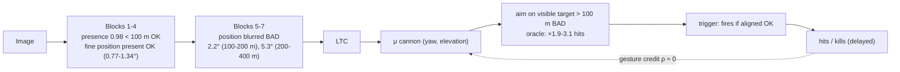

# Agent aim — what run 552 established (2026-11-23/24)

Runs: 552 (reference), 551, 550, 545, 536, 520/522; other-PC variant under test.
Report written for the Claude session of the other PC, which tests **4-block CNN + auxiliary head wired directly onto it + spatial softmax → LTC → action / value heads**. Goal: decide whether this architecture does better than 552's (**flattened 7-block CNN, auxiliary head wired at block 4**). `outputs/` is not versioned: the folder (report + `scripts/`) was meant to be copied as is; archive: `outputs/comparisons/2026-11-24_rapport_visee_552.zip`; sources and scripts: `outputs/comparisons/2026-11-24_rapport_visee_552/`.

## 0. In one sentence

In 552, the agent's margin is **fine aiming (< 1°) of visible targets beyond 100 m**; the trigger follows as soon as aim is good; the architecture **can** localise to < 1° and the fine position **exists at block 4**, but **blocks 5-7, learned by PPO alone, blur it** (2.2° at 100-200 m, 5.3° beyond) — which the 4-block variant removes by construction. Remains to prove that the spatial softmax transmits this precision and that PPO uses it.

## 1. Run 552 (reference)

- `ppo_liquid`, code `db9a825a` (+ uncommitted metric `pres`), launched 23/11 19:27, running at 1.11 M.
- Vision 256×128, 7-block CNN (conv 3×3 stride 2 no bias + GroupNorm [2,4,8,16,16,16,16] + SiLU), channels 16-32-64-128-128-128-128, flattened output 128×1×2 = 256 → liquid cell 128 → heads.
- Presence head: 1×1 conv on the block-4 map (128×8×16), target = 1 on cells covered by a living enemy in clear sight (footprint 7 m × 3 m), plain BCE, separate Adam lr 3e-4, one pass per rollout after PPO, on actor **and** critic, gradient into shared blocks 1-4.
- Single GAE advantage (λ 0.95, γ 0.998), no Φ nor separate credit; event reward.
- Curriculum: D 1000 at **699 k** (551 without head: 786 k; 545 with Φ₂: 429 k).
- CSV at D 1000 (699 k → 1.11 M): **kill 19.3, hit 0.38, fire 0.42, miss 46 m** (551: 20.6 / 0.29 / 0.58 / 62 m; 545: 20.4 / 0.37 / 0.29 / 64 m). Kill flat 18-24 over 400 k. Throughput −9 % for the head.
- Peculiarity: cannon held low (−8 to −18°) until save_10, risen to −4/−5° at save_41.

## 2. Diagnostic chain (each link measured)

### 2.1 Perception: the presence head works (save_10)

- Map learned online: visible enemies detected on the footprint at 1 % false positives 0.98 / 0.98 / 0.92 / 0.88 / 0.74 at < 60 / 60-100 / 100-200 / 200-400 / > 400 m (cell AUC 0.99); critic 2-10 points below. Script `carte_presence.py` (prediction recomputed from `actor.pt`).
- Target of "ignored" passes decodable at the CNN output: AUC target vs no target 0.94 (551 without head: 0.74). Script `decodage.py`.
- But turret reaction to a crossing target, < 60 m, good elevation: 0.29 (≡ 550). ⟹ seeing the target is not enough.

### 2.2 Where the margin is: oracles on save_41 (`oracle_lecture.py`)

Probe `arenai_agent_probe` with `--oracle --oracle_fov 79` (the oracle slaves only on the nearest enemy **in view**) and `--oracle_policy_{yaw,pitch,fire}` to leave one piece to the policy. 3 episodes per side. Hits/tank-s; kills/episode:

| | side 550 | side 1000 |
|---|---|---|
| policy | 0.275 ; 25.3 | 0.119 ; 17.7 |
| deterministic policy | 0.306 ; 27.3 | 0.113 ; 18.0 |
| oracle yaw in view (elevation + trigger policy) | 0.230 ; 25.7 | 0.088 ; 17.7 |
| oracle yaw 360° | 0.390 ; 27.7 | 0.170 ; 30.7 |
| **oracle yaw + elevation in view, policy trigger** | **0.527 ; 32.0** | **0.365 ; 28.3** |
| oracle trigger, policy aim | 0.079 ; 17.3 | 0.036 ; 7.7 |
| all oracle in view | 0.766 ; 30.7 | 0.756 ; 43.7 |

- Under oracle aim the policy's trigger **fires alone** (1.2-1.3 shells/tank-s) and the gain is beyond 100 m (hits > 100 m 0.25 versus 0.07 side 550). The aim/trigger co-adaptation of 520/522 has disappeared.
- Yaw alone useless: elevation error at firing +0.5 to +2.8° (target above the aimed point); under oracle 0.24-0.39°. Both axes are needed.
- σ ruled out (deterministic ≡ stochastic).

### 2.3 Gesture credit is null (`credit_geste.py`)

$$\rho=\operatorname{corr}\big(\hat A_t,\ \varepsilon_t s_t\big),\quad \varepsilon_t=\frac{\operatorname{atanh}(a_t)-\mu_t}{\sigma_t},\quad s_t=-\operatorname{sign}(e_t)$$

($\hat A$ recomputed from the probe's `value` column and `return_scaler.pt`, $e$ = yaw or elevation+drop error toward the nearest enemy.) Yaw: −0.015 to +0.016 everywhere and at any λ; elevation +0.01-0.03 at < 100 m, 0 beyond (± 0.007-0.011). Dense standard (reward = drop of |error|): only 0.03-0.05. Decomposition:

$$\rho\approx\frac{|\partial e/\partial\varepsilon|\;|\partial V/\partial e|}{\operatorname{sd}(\delta)}=\frac{0{,}5^\circ\times 0{,}005/^\circ}{0{,}155}\approx 0{,}015$$

(sweep: median |μ| 0.97, tanh′ ≈ 0.44, one noise step moves the target 0.4-0.6°; slope of V 0.05 per 10°, six times under the geometric value).

### 2.4 Credit remedies refused by Samuel (do not re-propose)

- **A — separate cannon credit on Φ (Φ₂)**: refused on principle (Φ freezes the target in place of the event reward; an invariant shaping $r+\gamma\Phi'-\Phi$ gives $A'=A$, hence no extra information). Measured anyway: ρ 0.03-0.06 (`credit_phi.py`).
- **B — gradient through an action value $Q(s,a)$ (or SVG through latent dynamics)**: set aside. Stein lemma: $\mathbb E[\nabla\mu\,\partial Q/\partial a]=\mathbb E[\nabla\mu\,A\varepsilon/\sigma]$, same information as PPO. Measured: ∂Q/∂a toward target 76-79 % but identical when Q sees only μ (inter-state correlation); with noise alone, null even on the standard (`banc_q.py`, `banc_svg.py`).

### 2.5 The result that concerns the other-PC architecture: fine position (`banc_position_fine.py`)

Images of the 2026-11-23 bench (551 save_20, **forced zoom**, field 45° × 22.5°, 127 k images, 25.6 k for training with visible enemy < 400 m, test = unseen episode 15.3 k). Reading Linear(256→128)-LN-SiLU-Linear(→2) on the block-7 output, target (ndc_x, ndc_y) of the nearest visible enemy, smooth L1, Adam 3e-4, 4 passes. Yaw: left/right correct (> 1° from axis) / median error / share < 1°; elevation: median error.

| configuration | 60-100 m | 100-200 m | 200-400 m |
|---|---|---|---|
| CNN 552 frozen (= what the policy receives) | 0.92 / 1.26° / 42 % ; 0.61° | 0.89 / **2.19°** / 27 % ; 0.82° | 0.77 / **5.34°** / 13 % ; 1.18° |
| blocks 1-4 of 552 frozen, 5-7 relearned | 0.94 / 0.92° / 53 % ; 0.43° | 0.94 / **0.77°** / 58 % ; 0.36° | 0.89 / **1.34°** / 41 % ; 0.49° |
| CNN 552 fully fine-tuned | 0.94 / 0.83° / 56 % ; 0.44° | 0.94 / 0.63° / 64 % ; 0.31° | 0.90 / 0.94° / 52 % ; 0.40° |
| same 7 blocks, fresh weights | 0.92 / 1.04° / 49 % ; 0.54° | 0.92 / 1.04° / 49 % ; 0.47° | 0.81 / 2.64° / 29 % ; 0.77° |
| always at centre | 7.04° | 10.67° | 11.33° |

- The architecture reaches < 1° up to 400 m when asked to.
- Fine position **is present at block 4** of 552 (formed by PPO + presence); **blocks 5-7 of 552 degrade it** by a factor 3-4 beyond 100 m.
- Need: a 3 m tank at 200 m = 0.86°; in zoomed field 1° ≈ 5.7 px of 256; a block-4 cell (16 px) ≈ 2.8° zoomed, 5° unzoomed ⟹ reading the 8×16 map must interpolate below the cell.
- Reservations: supervised reading (does not say what PPO will do with it), one seed, 551 images at forced zoom.
- A first per-stage measurement (`gisement_par_etage.py`, reading Conv 1×1 → 8 channels, 8.6 k images) concluded "coarse from block 3": **false**, reading too weak. Do not reuse as is.

### 2.6 Bench of 2026-11-23 on readings (`banc_lectures.py`, report `2026-11-23_origine_balayage` §10; see `2026-11-23_sweep-origin.md`)

Same image set, yaw only, < 200 m, left/right / median error:

| regime | reading | < 60 m | 60-100 m | 100-200 m |
|---|---|---|---|---|
| presence + reading, all trained | 4 blocks + spatial softmax | 0.855 / 2.43° | 0.940 / 1.26° | 0.917 / 1.23° |
| | 4 blocks + flattened 8×16 | 0.917 / 1.55° | 0.943 / 1.36° | 0.916 / 1.74° |
| | 7 blocks flattened | 0.896 / 1.61° | 0.962 / 0.89° | 0.920 / 0.84° |
| blocks 1-4 trained by presence alone | 4 blocks + spatial softmax | 0.908 / 2.23° | 0.920 / 1.68° | 0.920 / 1.56° |
| | 7 blocks flattened | 0.908 / 1.58° | 0.953 / 0.89° | 0.931 / 0.86° |

Spatial softmax = pre-`cfb76a2e` implementation (x, y, max per channel, one learned temperature 0.80-0.88). In supervised mode it is **the least precise** (1.2-1.7° at 60-200 m, 2.2-2.4° at < 60 m) versus 0.84-0.89° for 7 blocks flattened. Not measured at 200-400 m, nor under PPO.

## 3. What this implies for the 4-block + spatial softmax variant

- **For**: it removes blocks 5-7, precisely the stage where 552 loses the position; presence supervision acts on the very map the policy reads (direct coupling, which 552 lacks).
- **Against / to check**:
  1. spatial softmax precision: 1.2-1.7° supervised at 60-200 m (bench 23/11), above the 0.86° threshold at 200 m; the softmax returns an expectation per channel — a channel seeing two enemies or background gives a biased mean; temperature matters;
  2. the softmax loses presence and size except the per-channel max; check that the policy still knows "no target";
  3. **available precision ≠ used precision**: gesture credit remains null (§2.3); a better representation is necessary, not proven sufficient;
  4. old failure to keep in mind: run 536 (spatial softmax, no presence head) lost.

## 4. How to compare the two architectures (fast evaluators, at equal D)

Always compare at **equal D**, never at equal index; seed noise: D milestone ±30 k, hit/shell ±1 point.

| measure | tool | 552 reference |
|---|---|---|
| kill, hit, fire at D 1000 | CSV | 19.3 / 0.38 / 0.42; D 1000 at 699 k |
| **position precision at the policy's input** | `banc_position_fine.py`, "frozen" config, reading on the vector the LTC receives (adapt `Net`: 4 blocks + softmax frozen) | 1.26° / 2.19° / 5.34° (60-100 / 100-200 / 200-400 m) |
| same, architecture ceiling | same script, "fine-tuned" config | 0.83° / 0.63° / 0.94° (7 blocks) |
| remaining margin | oracles §2.2 (`oracle_lecture.py`) | oracle yaw+elevation ×1.9 (550) / ×3.1 (1000) |
| real aim | probe: turret<5°, hit/shell, hits/tank-s per band > 100 m | turret<5° 0.17-0.19; hit/shell 0.34-0.37 |
| reaction per pass, good elevation | `site_et_reaction.py` | < 60 m 0.58-0.91; 60-100 m 0.56-0.57 (550: 0.33-0.35) |
| gesture credit | `credit_geste.py` | ρ ≈ 0 |
| presence map | `carte_presence.py` (adapt if head moves) | 0.98 / 0.98 / 0.92 / 0.88 / 0.74 |

Proposed reading rule: the 4-block variant is better **for the targeted cause** if, at equal D, the frozen position error at 100-400 m falls under 552's (2.19° / 5.34°) **and** if the oracle yaw+elevation / policy ratio drops (margin closes); it is better **for the result** if hits/tank-s > 100 m and kill at D 1000 exceed 552.

## 5. Practical notes for the scripts

- All expect `arenai_agent_probe` exports: `.csv` (one row per tank-decision), `_shots.csv`, `_rewards.csv`, and depending on the case `--features` (`.bin`: header episode/step/tank + LTC features 128 + CNN output 256; **to adapt** for the variant), `--sightings`, `--presence`, `--frames` (`--frames_every N`, 10-float header including view_yaw/view_pitch).
- `credit_geste.py` hardcodes the return normaliser's std of 552 save_41 (√2.5348): read it from the probed checkpoint's `return_scaler.pt` (`torch.jit.load`, buffer `var`).
- Hardcoded paths to `outputs/train_552_ppo_liquid/...`: to replace.
- The image set of `banc_position_fine.py` / `banc_lectures.py` (`outputs/comparisons/2026-11-23_origine_balayage/data/banc_551_s20_zoom.*`, 12 GB) is not in this folder; regenerate one with the probe: `--zoom on --frames <f> --frames_every 1 --sightings <s>`.
- Verified sign conventions: `corr(act_canon_x, Δyaw target)` = +0.79 ⟹ "toward target" = −sign(yaw); turret plant Δyaw ≈ 9.3·a(t) + 9.0·a(t−1) °/decision; ballistic drop $\arctan\big(g\,d/(2v^2)\big)$, $g$ 9.8, $v$ 250 m/s.
- Always regress the advantage on $\varepsilon=(\operatorname{atanh}a-\mu)/\sigma$, never on the raw action (state confounding).
