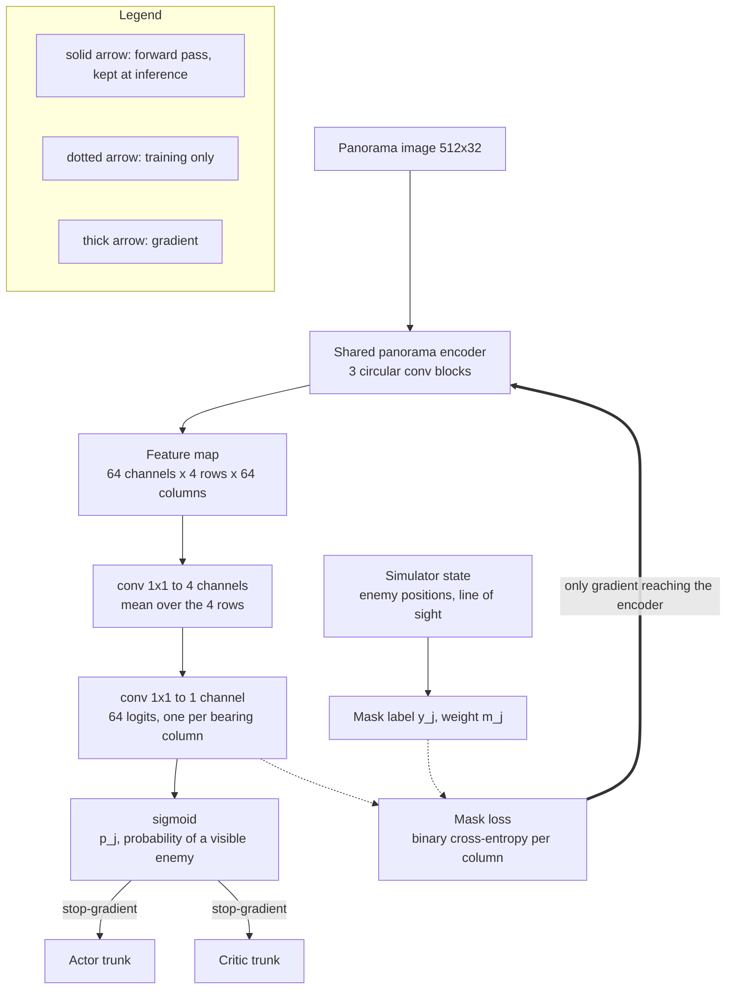

# Plan — panorama encoder trained by an enemy-visibility mask

Work plan (skill `work-plan`): delete this file in the commit that completes it.

## Status

2026-11-27, nothing coded, every piece validated the same day (§Validated pieces). Samuel chose the direction himself: « ne faut-il pas que le cnn
panoramique soit partagé entre l'acteur et la critique, et soit entraîné en mode masque sur les
ennemis visibles ? et ses features sont injectées (selon une méthode à benchmarker) à l'acteur et
la critique ? », then asked for the best version with « masque seul dans la loss » and said
« okay je l'ai […] je lancerai une nouvelle session pour le coder ». The plan
re-opens, on the panorama encoder only and with new bench evidence, the presence-head lever
recorded as removed on 2026-11-25 in `docs/decisions.md`.

## Why

Runs 554 (row maximum) and 555 (row mean) feed a full-turn panorama to the actor and the critic,
each with its own panorama encoder. Measured on save 17 of both runs:

- the actor's panorama encoder is at the level of an untrained one; the bearing of an off-field
  enemy is not decodable from the liquid trunk (left/right 0.48–0.58, chance 0.50);
- the share of the advantage explained by the turret exploration noise towards the target is
  `|ρ| ≤ 0.015` in every distance and bearing band (noise floor): the policy gradient carries
  no usable signal to shape an encoder;
- the critic's encoder sees near enemies only: the return depends on the nearest enemy's
  position under 100 m (out-of-sample R² 0.21 at a 1–3 s horizon) and not at all at 100–200 m
  (R² 0.00 at every horizon), because no event involves an enemy beyond 100 m.

Bench conclusions (one-step policy-gradient bandit on labelled panoramas, see §Evidence):

- the supervised ranking of aggregations does not transfer to a policy gradient: every
  aggregation is within seed range at every signal level;
- what blocks is the representation: with an already-trained frozen encoder, the same weak
  signal trains the turret head; with the encoder trained by that signal, nothing is learned;
- a scalar target (value, even a value that would depend on far enemies) does not teach far
  bearing; a per-bearing target does;
- the more compact and explicit the quantity read by the head, the less the weak signal matters.

## Design

One panorama encoder, shared by the actor and the critic, trained only by a mask loss. The
trunks read the 64 predicted probabilities; policy and value gradients stop there.

### Mask label

One label per bearing column, common to the 4 rows (no elevation information). With 64 columns
of 5.625° in the turret frame:

- `y_j = 1` if an enemy with a clear line of sight, closer than 400 m and within the panorama's
  vertical field, has its bearing inside column `j`; else 0;
- `m_j = 0` for an ambiguous column (an enemy overlaps it by its angular half-width
  `atan(4 m / distance)` but is occluded, too far or centred in a neighbouring column); else 1.

Labels come from the simulator state, never from the image, and exist at training time only.

### Loss

$$\mathcal{L}_{mask}=\frac{1}{\sum_j m_j}\sum_{j=1}^{64} m_j\,\mathrm{BCE}\big(\ell_j,\ y_j\big)$$

`ℓ_j`: logit of column `j`. Separate optimiser step from the policy and value losses, as nothing
else trains the encoder.

### Trunk input

$$p_j=\sigma(\ell_j),\quad j=1..64$$

The 64 detached `p_j` replace the 256 panorama features at the input of both trunks (Samuel set
the bearing summary aside: « juste les 64 proba »; bench row "mask 64 columns → 64
probabilities"). Column `j` is centred on bearing `(31.5 − j) × 5.625°` from the canon heading,
positive to the left (`make_panorama_cameras`: view 0 is the leftmost).

## Evidence

Scripts and CSV in `outputs/comparisons/2026-11-25_exploration/` (local, not versioned):
`banc_bandit.py`, `banc_fige.py`, `banc_cibles.py`, `banc_injection.py`. Encoder pre-trained on
one target, frozen, then a linear turret head trained by a score-function gradient whose
advantage has correlation `ρ` with the useful exploration noise. Accuracy of the side of the
nearest off-field enemy (chance 0.50), under 60 m / 60–100 m / 100–200 m, mean of 2 seeds:

| encoder target → quantity read by the head | size | ρ = 0.05 | ρ = 0.02 |
|---|---|---|---|
| policy gradient itself (554/555 situation) | 256 | 0.50–0.53 / 0.52–0.55 / 0.51–0.56 | — |
| real critic encoder, 555 save 17 → features | 256 | 0.72 / 0.59 / 0.52 | 0.65 / 0.58 / 0.51 |
| mask 64 columns → encoder features | 256 | 0.67 / 0.67 / 0.67 | 0.64 / 0.63 / 0.65 |
| **mask 64 columns → 64 probabilities (this design)** | 64 | 0.70 / 0.71 / 0.70 | 0.65 / 0.65 / 0.64 |
| mask 16 cells → 16 logits | 16 | 0.68 / 0.72 / 0.73 | 0.67 / 0.71 / 0.72 |
| mask 64 columns → bearing summary | 3 | 0.73 / 0.73 / 0.74 | 0.70 / 0.71 / 0.71 |
| mask + per-column proximity → proximity-weighted summary | 3 | 0.80 / 0.82 / 0.75 | 0.76 / 0.78 / 0.73 |

Mask AUC on held-out panoramas: 0.84 (64 columns), 0.88 (16 cells).

Limits of the bench: one-step bandit, linear head, 2 seeds, bench panoramas offset by 45° from
the agent's views, task = side of the nearest enemy (favours the proximity weighting), and the
real `ρ` (≈ 0) is below the lowest level tested. The bench shows that a trained encoder divides
the signal needed; it does not show that the turret will aim in a real run.

Real-run measurements behind §Why: memory note `run-555-panorama-moyenne-debut` (and
`run-554-panorama-debut`), probe exports `outputs/train_55{4,5}_ppo_liquid/features/save_17_side1000*`.
Trap met while measuring `ρ`: the probe exports the action after tanh and `μ` before it; the
exploration noise is `ξ = (atanh(act) − μ) / σ`, and the good direction is `s = −sign(yaw)`.

## Out of scope

- The aiming credit itself stays near zero; the trained encoder only makes what little there is usable.
- The bearing summary (3 values: mean cos, mean sin, max probability; best single-label bench
  row) and its proximity-weighted variant were set aside: the trunks read the 64 probabilities.

## Validated pieces

All validated by Samuel on 2026-11-27 through `AskUserQuestion`, signatures as shown to him.

- **Scope**: the four agents (« Les quatre agents »). `PanoramaNetwork` is replaced everywhere by
  `PanoramaMaskNetwork` (`networks/panorama_mask.h`).
- **Ownership**: « Injecté aux deux ». The factory builds the encoder and injects it by
  constructor (`const std::shared_ptr<PanoramaMaskNetwork> &panorama_encoder`) into the actor,
  the critic and the trainer, replacing their 3 `panorama_*` parameters; it is a submodule of
  both networks, hence written in `actor.pt` and `critic.pt`; the game loads `actor.pt` alone.
  `act` / `value` signatures unchanged.
- **Gradients**: « Stop-gradient ». Only the mask loss trains the encoder.
- **Trunk input**: « 64 probabilités seules ».
  `torch::Tensor logits(const torch::Tensor &panorama)` → `[B, columns]`;
  `torch::Tensor forward(const torch::Tensor &panorama)` → `[B, columns]` detached probabilities.
- **Label source**: « Faits géométriques ». `core/train_environment.h`:
  `struct EnemySighting { float bearing; float angular_half_width; float distance; bool visible; }`
  (rad from the canon heading, positive to the left; rad; m; clear line of sight inside the
  panorama's vertical field) and
  `std::vector<std::optional<std::vector<EnemySighting>>> TrainTankEnvironment::enemy_sightings()`
  (nullopt for a dead tank). `core/panorama_mask_labels.h`:
  `struct PanoramaMaskLabels { torch::Tensor labels; torch::Tensor weights; }` (`[columns]`) and
  the pure `PanoramaMaskLabels panorama_mask_labels(const std::vector<EnemySighting> &sightings, int columns)`.
- **Label path**: « Apprenant alimenté ». `agents/panorama_mask_learner.h`,
  `PanoramaMaskLearner(encoder, learning_rate, batch_size, epochs, device)` with
  `observe(panorama, sightings)`, `fit()` (passes over the observations since the last fit, then
  forgets them), `save(output_folder)`; `AbstractTorchAgentFactory::get_panorama_mask_learner()`;
  each of the 4 trainers receives the learner by constructor and calls `fit()` at the end of its
  own update; `train.cpp` calls `observe(state.get_panorama(), env->enemy_sightings())` before
  `agent->act`. Collectors and buffers unchanged.
- **Optimiser**: « Tout en options CLI ». Separate Adam; per agent `--panorama_mask_learning_rate`
  (3e-4), `--panorama_mask_batch_size` (512), `--panorama_mask_epochs` (1).
- **Metric**: « csv + progress bar ». `mask_loss` (mean BCE per batch), owned by the learner,
  shown in the progress bar and written to the CSV.
- **554/555 checkpoints**: no fallback (design doctrine); probed and matched with a binary built
  in a worktree at `a3e0b27d`.

## Open pieces

None.

## Steps

1. Read `docs/neural_architecture.md`, `docs/ARCHITECTURE.md` and the panorama encoder, actor,
   critic and trainer code of `arenai_agent` (`networks`, `agents/ppo_liquid`); note how the two
   networks are built, saved and loaded by the desktop game. Verify: the facts of this plan
   against the tree.
2. Done 2026-11-27: every piece validated (§Validated pieces).
3. Mask label: `enemy_sightings()` and the pure `panorama_mask_labels`. Verify: unit test on
   synthetic sightings (one enemy at a known bearing, one occluded, one beyond 400 m, one
   straddling two columns).
4. `PanoramaMaskNetwork` shared and injected in the networks of the four agents, stop-gradient,
   trunk inputs. Verify: shapes; no gradient reaches the encoder from a policy or value loss;
   the game still loads and plays a checkpoint. SAC: check the target-network soft update does
   not run twice on the shared encoder.
5. `PanoramaMaskLearner`, its options and metric; the four trainers call `fit()`; `train.cpp`
   feeds it.
6. Update `docs/neural_architecture.md`, `docs/ARCHITECTURE.md`, `docs/USAGE.md` (new options),
   `docs/decisions.md` (decision row); `final-check`.
7. Smoke run into the scratchpad, then hand Samuel the binary and the command (G4: he launches).

## Evaluators

- Smoke run into the scratchpad: mask loss decreasing, held-out mask AUC against the bench's
  0.84.
- On the first saves of a real run: side of the nearest off-field enemy decodable from the
  trunk output (`decode_panorama.py`, 554/555 save 17: 0.48–0.58); prediction if the design
  works: clearly above 0.60 under 100 m and at 100–200 m (bench, 64 probabilities: 0.70).
- Verdict on the run: game match only (`docs/rl_method.md` M7), against 555 save 17.
