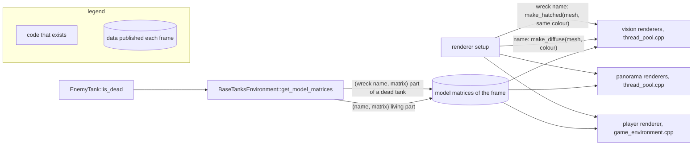

# Wreck rendering — a dead tank must look dead

## Status

`validated` — 2026-11-27. Pieces P1-P3 answered the same day (see **Validated pieces**); plan committed, execution left to a later session (Samuel: « Nouvelle session »).

Decided by Samuel (2026-11-27): after seeing the agent fire at wrecks in game (« je l'ai constaté en jeu »), he
chose « Mesurer d'abord », then « ouai on teste avant » for the decoding test, then « Oui, plan rendu » to the
question « Je rédige le plan d'un rendu distinct de l'épave (jeu et vision de l'agent) ? ». This validates the
principle only: a wreck gets a rendering distinct from a living tank.

Not decided: any training (G4, piece P4).

## Why

Symptom (run 556, `5367a45e`, ppo_liquid, D 1000; knowledge base
`.claude/knowledge/runs/2026-11-27-02-00-15_ElMatador_train_556_ppo_liquid/`):

- Game matches s17 / s21 / s24 (`matches/save_24.md`): 24-27 % of living tanks dry at 10 s at side 1000
  (554 s17 / 555 s17: 3-4 %), unchanged over three saves while the gun elevation recovers.
- `matches/early_dump.md`: 5.1-5.7 shells/tank in the first 10 s (554 / 555: 2.3-2.9); the tanks that dump do
  not spawn nearer to an enemy.
- `probes/save_24_offtarget_frames.md`: on 24 random off-target firing frames the agent fires at an object
  centred in the zoomed image: 14 tanks, 10 map items. 554 s17 does the same half as often.
- `probes/save_24_wrecks.md` (s24, deterministic, side 1000): a wreck on the gun axis is fired at on
  0.37 / 0.47 / 0.17 of decisions at < 60 / 60-100 / 100-200 m, a living enemy on 0.74 / 0.62 / 0.21; nothing
  within 20°: 0.012. 14 % of all shells go to a wreck on the axis.
- `probes/save_24_wreck_decoding.md`: « wreck vs living tank » decoded at 0.58-0.69 by a CNN trained on the
  pixels and 0.56-0.66 from the agent's vision features (chance 0.50), while « tank on the axis vs nothing » is
  decoded at 0.80-0.98 by the same CNN. Script: `outputs/train_556_ppo_liquid/features/decode_wrecks.py`.

Refuted: « the detached parts are enough and the agent does not use them » (decoding near chance at every
distance, under 60 m included). Ruled out as remedies: changing the respawn, « leaving wrecks in training » —
a killed tank already stays as a wreck until the episode ends (`TrainTankEnvironment::step` respawns only a
tank with an empty reserve); at one third of a probe episode 15 of 32 tanks are wrecks.

Code facts at `62ba85c7`:

- `JoltEnemyTank::on_death` (`arenai_model/src/tank/jolt_enemy_tank.cpp`) removes the constraints and kills
  every life item: a shell on a wreck pays no hit reward and no shell.
- `arenai_view` has no dead state. Every drawable is registered once per renderer under the item's name with a
  random colour: `arenai_core/src/thread_pool.cpp` (agent vision renderer and panorama renderers, one set per
  enemy tank thread, colours uniform in [0, 1]³) and `arenai_desktop/src/core/game_environment.cpp` (player
  renderer, colours uniform in [0, 0.8]³). A tank has no team colour: each part has its own random colour.
- Each frame, `BaseTanksEnvironment::get_model_matrices()` (`arenai_core/src/environment.cpp`) returns
  `std::vector<std::tuple<std::string, glm::mat4>>` (item name, model matrix) built from
  `physic_engine->get_items()`; it goes to `ThreadPool::set_model_matrices` and to `on_draw`.
  `AbstractRenderer::draw(model_matrices)` draws the drawable registered under each name.
- The panorama mask labels exclude dead tanks (`TrainTankEnvironment::enemy_sightings`).

Cause the remedy removes (M6): the observation does not contain the state « this tank is dead ». Making it
visible puts the information in the input; nothing is added to the reward.

## Design

A wreck keeps the colour of each of its parts, crossed by dark diagonal hatching fixed to the screen. The
wreck is a second drawable of the same mesh under a derived name; the environment, which knows which tank is
dead, publishes the parts of a dead tank under that name. No renderer state, restored for free when the tank
is respawned (the name is derived from `is_dead()` every frame).



Legend: boxes = existing code units changed by the plan; cylinder = the per-frame list every renderer reads;
labelled arrows = what flows.

Hatching, in framebuffer pixels $(x, y)$ of a render of height $h$ pixels, base colour $c$:

$$p = \frac{h}{32}, \qquad \text{colour}(x, y) = \begin{cases} 0.2\,c & \text{if } (x + y) \bmod p < p/2 \\ c & \text{otherwise} \end{cases}$$

$p$ = hatch period (4 px on the 128 px agent vision, ≈ 34 px on a 1080p player view, 1 px on the 32 px
panorama); 0.2 = darkening of a band, the value of the mockup Samuel chose from
(`wreck_hatching_mockup.png`, generated in the session scratchpad, not kept). The hatching applies to the lit
colour of the fragment; shadows and post-processing as for `make_diffuse`.

Shared surfaces, signatures validated character for character:

```cpp
// arenai_core/include/arenai_core/environment.h
namespace arenai::core {
    // drawable name of an item once its tank is dead
    std::string wreck_drawable_name(const std::string &item_name);
}

// arenai_view/include/arenai_view/drawable.h, class AbstractDrawableFactory
// diffuse color crossed by dark screen-space hatching
virtual std::unique_ptr<AbstractDrawable>
make_hatched(const std::shared_ptr<AbstractMesh> &mesh, glm::vec4 color) = 0;
```

Call sites: `BaseTanksEnvironment::get_model_matrices` (emit the wreck name), `thread_pool.cpp` and
`game_environment.cpp` (register `make_hatched` under the wreck name for each tank part, with the colour drawn
for that part). The player's tank parts and the map items get no wreck drawable.

## Validated pieces

- Principle: a wreck is rendered distinctly from a living tank (Samuel, 2026-11-27, « Oui, plan rendu »).
- P1 look: Samuel proposed « on garde les couleurs mais qu'on ajoute des motifs sur les pièces de l'épave »,
  asked for a mockup at several distances, then chose « Hachures écran, pas 4 px » (colours kept, dark diagonal
  bands 2 px every 4 px on the agent vision) over a 2 px pitch, a uniform dark colour and a pattern painted on
  the part (2026-11-27).
- P1b pitch in the other renders: « Proportionnel à la hauteur » — period = render height / 32 (2026-11-27).
- P2 mechanism: « Nom dérivé » — `wreck_drawable_name` as above (2026-11-27, design-gate).
- P2b drawable: « make_hatched(mesh, color) » as above, pitch and darkening constants of `arenai_view`
  (2026-11-27, design-gate).
- P3 scope: « Agent et joueur » — agent vision, agent panorama and player view (2026-11-27).

## Open pieces

- **P4 — training** (G4), after the code exists and E1 passed: Samuel launches it himself; the question carries
  hypothesis, reference run (556), decision rule (E3), stopping point, cost.
- Any private design choice inside `arenai_view` that turns out to touch another public header (pipeline or
  renderer interface) is a new design-gate question before coding it.

## Steps

1. `arenai_view`: read how `make_diffuse` drawables, the shared scene pipelines (`44f12436`) and the
   `diffuse_*` shaders are built; add the hatched drawable and its fragment shader(s)
   (`arenai_view/shaders/`, compiled by `cmake/ArenaiCompileShaders.cmake`), `make_hatched` in the public
   factory and its implementation(s). Verify: a view test rendering one hatched mesh offscreen (bands present,
   period = height / 32, base colour in the gaps).
2. `arenai_core`: `wreck_drawable_name`, `get_model_matrices` emits it for the parts of dead tanks.
   Verify: unit test in `arenai_core/tests` (a dead tank's parts come out under the wreck name, a respawned
   tank's under the item name).
3. `arenai_core/src/thread_pool.cpp`: register the hatched drawable of every tank part in the vision renderer
   and in the panorama renderers (own parts left out of the panorama as today).
4. `arenai_desktop/src/core/game_environment.cpp`: same in the player renderer.
5. Golden images: `./scripts/goldens_docker.sh`; a new golden for the hatched drawable is generated there;
   existing goldens are regenerated only if they contain a dead tank and Samuel confirms the change is intended.
6. Docs in the same commit: `docs/ARCHITECTURE.md` (view class diagram: `make_hatched`; frame sequence: what
   the model-matrix list carries), `docs/decisions.md` (decision row: wreck rendering, with the measurements
   of **Why**).
7. `final-check`, then the evaluators.

## Evaluators

- **E1 — pixels (fast, no training)**: replay 556 s24 with the new binary, probe side 1000, 8 episodes,
  deterministic, `--features` + `--frames --frames_every 1`, then
  `outputs/train_556_ppo_liquid/features/decode_wrecks.py`. Metric: balanced accuracy of the pixel CNN on
  « wreck vs living on the axis », per distance band, test episodes 6-7. Before: 0.58-0.69. Confirmed if ≥ 0.90
  under 200 m and ≥ the control (« tank vs nothing ») level at 200-400 m; refuted if < 0.80 under 100 m.
  Noise: 2 seeds differ by ≤ 0.03. Cost ~15 min. The checkpoint's network only produces the trajectories.
- **E2 — smoke**: disposable training of a few minutes in the scratchpad, no NaN, saves load, probe reads them.
- **E3 — behaviour (needs P4)**: on the trained run, `probes/save_K_wrecks` measure — share of decisions firing
  with a wreck on the axis vs with nothing within 20° — and the game match (dry at 10 s). Decision rule to
  write in the G4 question.

## Out of scope

- Map items: 47 % of the off-target shells of 556 s24 go to a decision with no wreck within 20° (cylinders,
  cubes, hemispheres on the frames). Not addressed here.
- The gun resting low and the parallax firing setpoint (`probes/save_21_gun_elevation.md`, `probes/timeline.md`).
- Removing wrecks from the scene, changing the respawn, any reward term on wreck hits.
