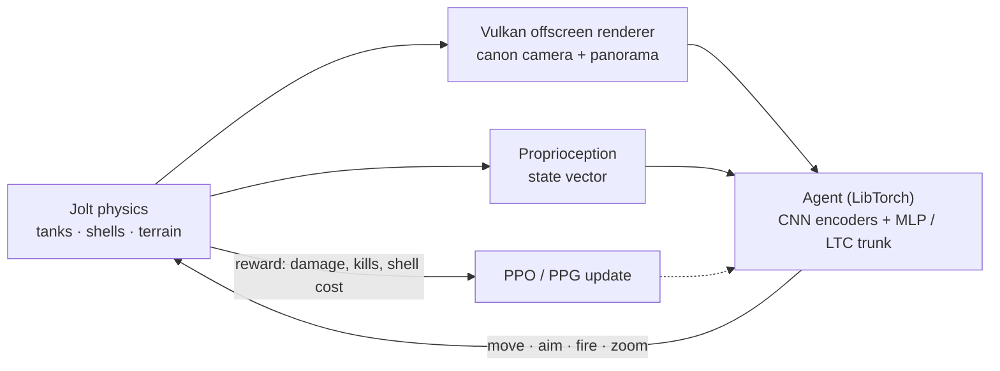

<div align="center">

# ArenAI

**A physics-based tank arena where every enemy is a reinforcement-learning agent that sees the world through its own camera.**

[](https://github.com/Ipsedo/ArenAI/actions/workflows/arenai-ci.yml)
[](https://github.com/Ipsedo/ArenAI/releases)


<!-- TODO: replace with a gameplay GIF (docs/images/gameplay.gif) -->
<!--  -->

[Play](#play) · [Train](#train-your-own-agent) · [How it works](#how-it-works) · [Docs](#documentation)

</div>

---

## Highlights

- 🎮 **Playable game** — drive a tank in a battle royale against trained agents (16 enemies by default, configurable), keyboard or gamepad, fully remappable controls.
- 👁️ **Pixels in, actions out** — each agent sees only what its tank sees: a 256×128 canon camera and a 360° panorama, rendered offscreen with Vulkan.
- ⚙️ **Real physics** — [Jolt Physics](https://github.com/jrouwe/JoltPhysics) for terrain, tracks, turret and ballistic shells.
- 🧠 **From-scratch RL in C++** — PPO, PPO with a liquid time-constant (LTC) recurrent core, and PPG, written on LibTorch; no Python in the training loop.
- 📈 **Self-play curriculum** — 32 tanks driven by the same agent; the arena grows from 250 m to 1000 m as they learn to hit each other.
- 📦 **Bundled agents** — pretrained `ppo`, `ppo_liquid` and `ppg` checkpoints ship with the game.

## How it works



Each tank outputs four continuous actions (chassis and canon joysticks, tanh-squashed Gaussian) and two discrete ones (fire, zoom, Bernoulli). Network details: [docs/neural_architecture.md](docs/neural_architecture.md).

## Play

### Prebuilt binaries

Download the archive for your platform from the [latest release](https://github.com/Ipsedo/ArenAI/releases) (Linux x86-64 / arm64, Windows, macOS arm64 — experimental).

<details>
<summary>macOS: the app is not signed</summary>

Unzip the archive, then in the folder containing `ArenAI.app`:

```bash
xattr -dr com.apple.quarantine ArenAI.app
```

</details>

### Build from source

Linux, with dependencies and LibTorch installed ([docs/BUILD.md](docs/BUILD.md)):

```bash
git clone https://github.com/Ipsedo/ArenAI.git
cd ArenAI
./build_linux.sh
./build/arenai_desktop/arenai_desktop
```

Windows (Visual Studio 2022, C++ workload), in PowerShell:

```powershell
.\install_dependencies.ps1
.\build_windows.ps1
```

## Train your own agent

```bash
./build/arenai_agent/arenai_agent_train \
    --output_folder outputs/train_001_ppo \
    --resources_folder resources \
    --cuda ppo
```

| agent | trunk | memory |
|---|---|---|
| `ppo` | MLP | none |
| `ppo_liquid` | LTC cell (128 neurons) | recurrent, TBPTT |
| `ppg` | MLP | none, auxiliary value phase |

Then load `save_K/actor.pt` from the game menu, or judge it under the game rules with `arenai_agent_match`. All options and defaults: [docs/USAGE.md](docs/USAGE.md).

## Documentation

| | |
|---|---|
| [BUILD.md](docs/BUILD.md) | dependencies, build per platform, CMake options, tests, golden images |
| [USAGE.md](docs/USAGE.md) | play, train, evaluate, Python tooling, every CLI option |
| [ARCHITECTURE.md](docs/ARCHITECTURE.md) | modules, class diagrams, frame and training sequences |
| [neural_architecture.md](docs/neural_architecture.md) | inputs, encoders, trunks, heads |

## Project structure

```
arenai_utils        caches, file reading, logging
arenai_controller   input handling
arenai_view         Vulkan renderer (window + offscreen agent vision)
arenai_model        Jolt physics, tanks, shells, items
arenai_core         environment, enemy handling, thread pool
arenai_agent        PPO / PPO liquid / PPG / SAC, training & evaluation executables
arenai_desktop      the playable game (RmlUi menus, HUD)
```

## Known issues

<details>
<summary>Periodic freezes on GNOME</summary>

The `system-monitor` GNOME Shell extension stalls the game periodically. Disable it while playing:

```bash
gnome-extensions disable system-monitor@gnome-shell-extensions.gcampax.github.com
```

</details>

## Contributing

Bug reports, build failures and ideas are welcome — [open an issue](https://github.com/Ipsedo/ArenAI/issues).
Code style is enforced with pre-commit (clang-format); see [docs/BUILD.md](docs/BUILD.md).
