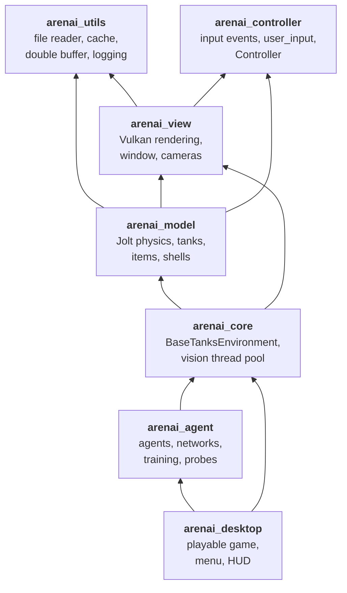
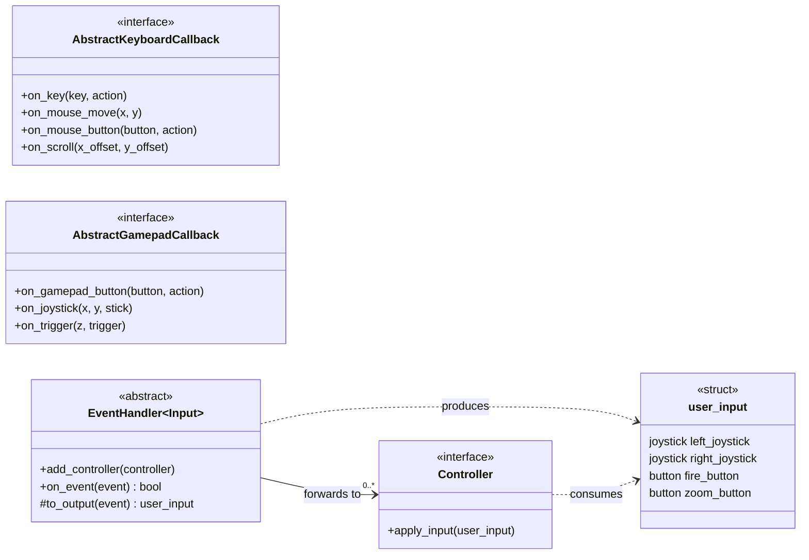
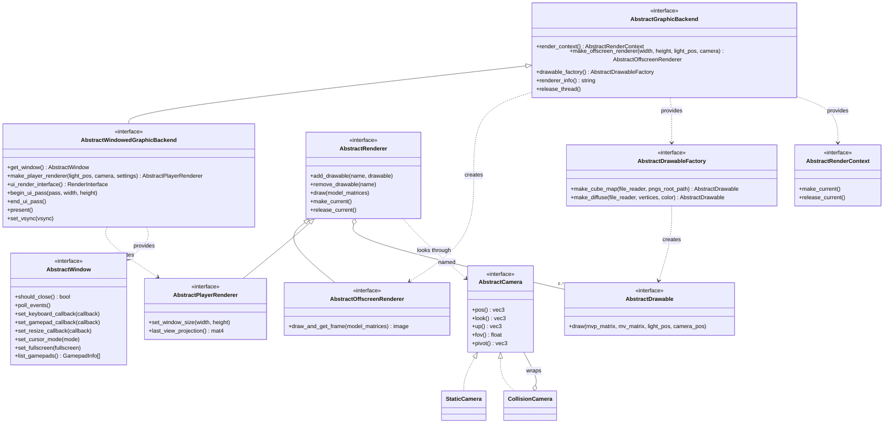
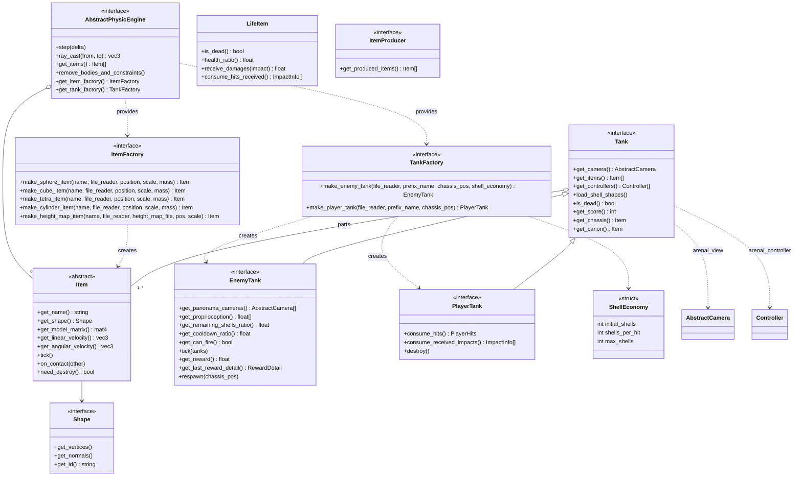
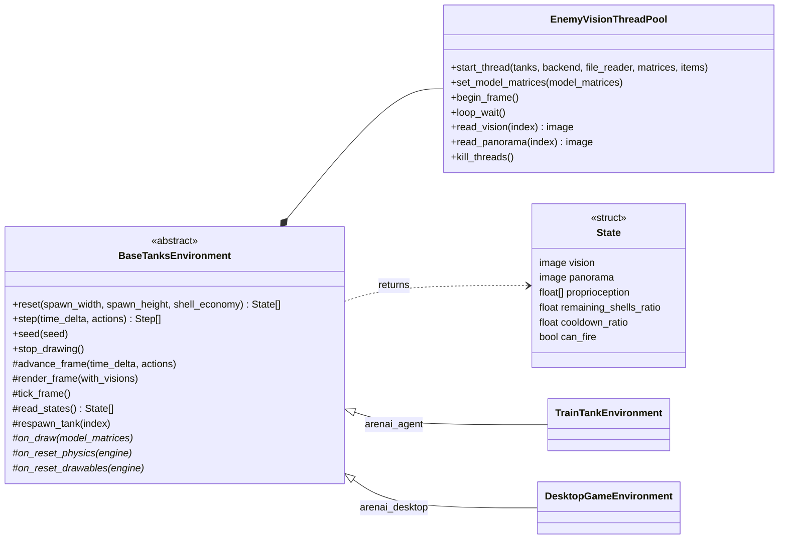
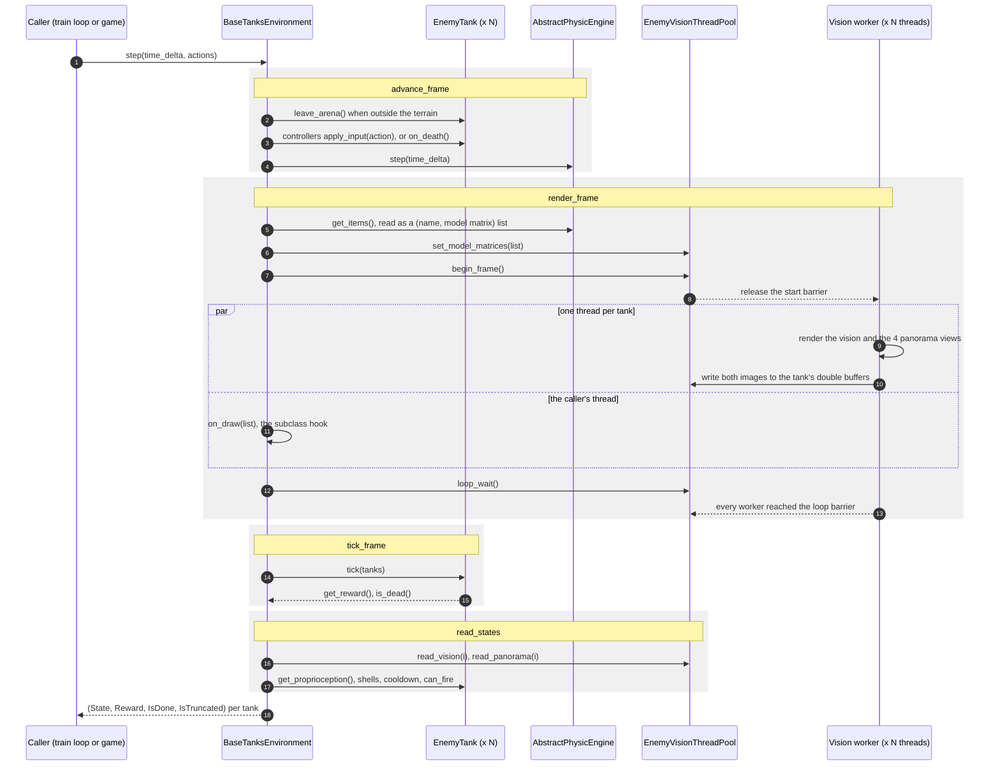
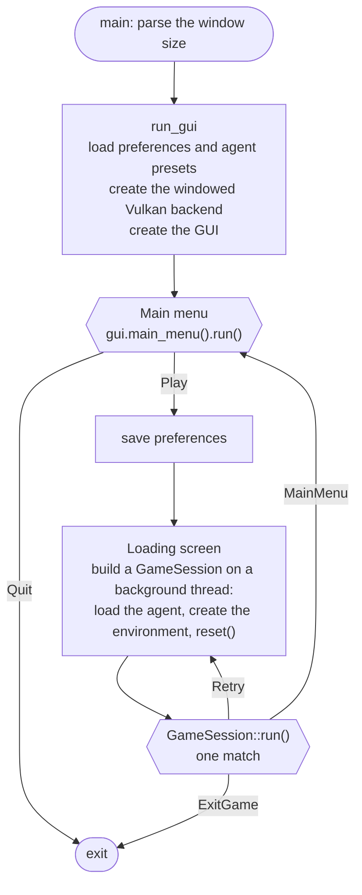
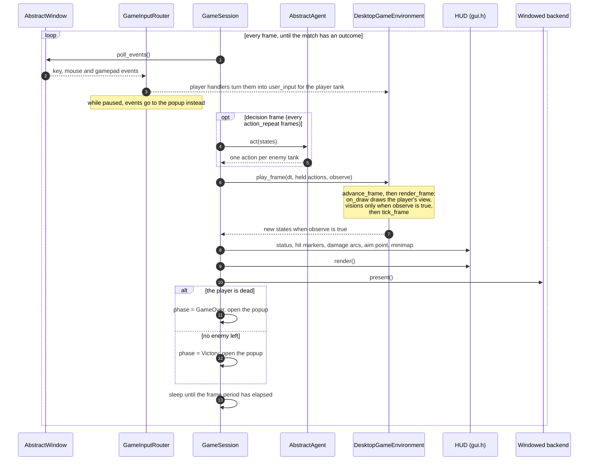
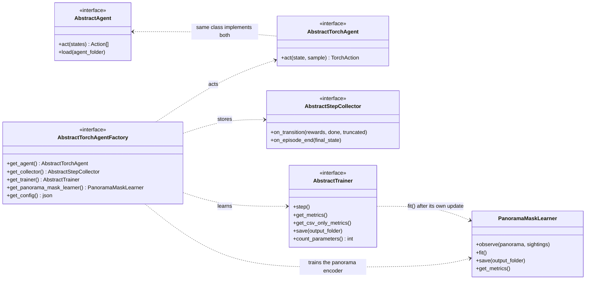
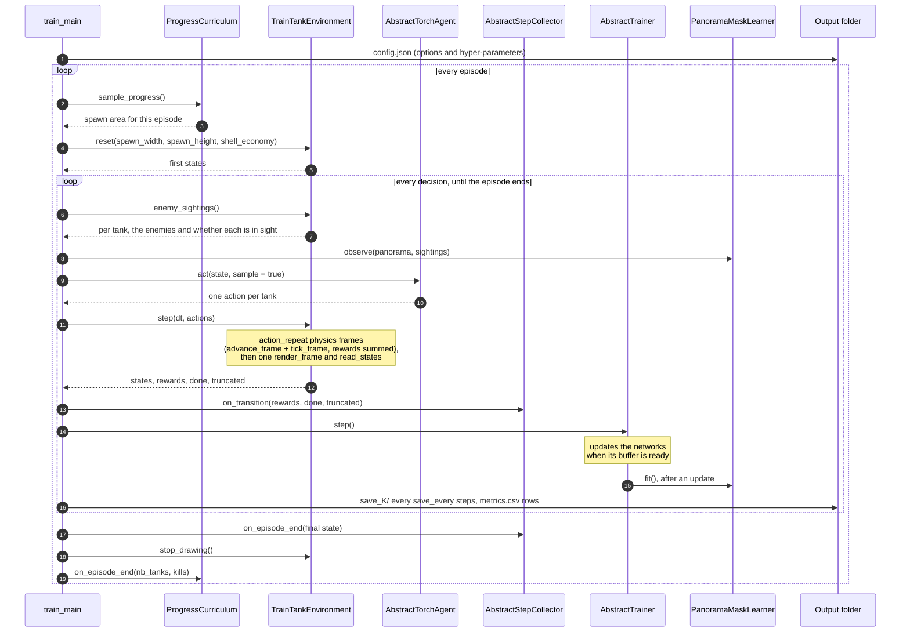

# Architecture

ArenAI is a tank-arena game whose enemies are neural agents trained by reinforcement learning.
Each enemy tank only sees what its own camera renders, plus a few body sensors, and drives the
same controls as the human player.

This document explains how the code is organised: the modules and their dependencies, the public
types of the three foundation modules (model, view, controller), and how a frame flows through
the simulation core, the desktop game and the training program. The neural networks themselves
are described in [neural_architecture.md](neural_architecture.md).

## Contents

- [Modules](#modules)
- [Public interfaces](#public-interfaces)
  - [Controller](#controller--arenai_controller)
  - [View](#view--arenai_view)
  - [Model](#model--arenai_model)
- [Core: one simulation frame](#core-one-simulation-frame--arenai_core)
- [Desktop: the playable game](#desktop-the-playable-game--arenai_desktop)
- [Training](#training--arenai_agent)
- [Where to change what](#where-to-change-what)

## Modules

The repository is a set of CMake targets, one folder each. Every library exposes its contract in
`<module>/include/<module>/` and hides its implementation in `<module>/src/`: the physics engine
(Jolt), the renderer (Vulkan), the windowing library (GLFW) and the UI library (RmlUi) never
appear in a public header.

An arrow reads "depends on". Dependencies only go downward in this picture; a lower module never
includes a header of a higher one.

| module | kind | role |
|---|---|---|
| `arenai_utils` | library | resource file reader interface, cache, lock-free double buffer, logging, singleton |
| `arenai_controller` | library | device-independent input: window event callbacks, the `user_input` command, the `Controller` interface |
| `arenai_view` | library | Vulkan renderers (window and offscreen), window and gamepad access, cameras |
| `arenai_model` | library | the simulated world: physics engine, items, tanks, shells, rewards |
| `arenai_core` | library | the environment: steps the world, renders every agent's vision in parallel, returns observations |
| `arenai_agent` | library + executables | the agents (`ppo`, `ppo_liquid`, `ppg`, `sac`), their networks, the training loop and the evaluation tools |
| `arenai_desktop` | executable | the game: menu, HUD, player input, one match against the trained agents |

Executables:

| executable | source | purpose |
|---|---|---|
| `arenai_desktop` | `arenai_desktop/src/main.cpp` | the playable game |
| `arenai_agent_train` | `arenai_agent/src/main.cpp` | trains an agent, writes checkpoints and `metrics.csv` |
| `arenai_agent_probe` | `arenai_agent/probe/probe.cpp` | measures a checkpoint's behaviour in the training environment |
| `arenai_agent_match` | `arenai_agent/probe/match.cpp` | plays a checkpoint under the game's rules, without a window |
| `arenai_agent_sigma_gradients` | `arenai_agent/probe/sigma_gradients.cpp` | gradient diagnostic on a checkpoint |

Other folders: `resources/` (meshes, height maps, cube maps, fonts, menu documents, shipped
trained models), `cmake/` (helper modules, shader compilation), `scripts/` (CI packaging, golden
image tooling), `arenai_agent/python/` (metrics visualisation, checkpoint conversion). Each
module has its own GoogleTest suite in `<module>/tests/`.

## Public interfaces

The three diagrams below show the public headers only. Each abstract type has one implementation
in `src/`, obtained through a factory function, so callers never name a concrete class.

### Controller — `arenai_controller`

The module separates two things: *what the device did* (callbacks fed by the window) and *what
the tank is asked to do* (`user_input`). An `EventHandler` translates the first into the second
and forwards it to `Controller`s.

`user_input` is the single command format of the project: the player's devices produce it, and so
does a neural agent (`core::Action` is an alias of `user_input`). A tank cannot tell who drives it.

`callback.h` also defines the device vocabulary (`Key`, `MouseButton`, `GamepadButton`,
`GamepadJoystick`, `GamepadTrigger`, `InputAction`, `CursorMode`), and `input_names.h` converts
keys and buttons to and from strings for the saved bindings.

### View — `arenai_view`

Everything starts from a **graphic backend**. `make_vulkan_backend()` returns a headless one
(training, agents' vision); `make_glfw_vulkan_backend()` returns a windowed one (the game). A
backend builds **renderers** bound to a camera and **drawables** (meshes ready to be drawn). A
renderer is then fed, each frame, the list of `(name, model matrix)` of the objects to draw.

- `AbstractOffscreenRenderer::draw_and_get_frame` returns the pixels: this is an agent's eye.
- `AbstractPlayerRenderer` draws the player's view in the window, with shadows, MSAA and
  post-processing driven by `PlayerRendererSettings`.
- `AbstractWindow` receives the callbacks of `arenai_controller`: the view owns the devices, the
  controller module owns their meaning.
- `CollisionCamera` decorates another camera and pulls it forward when an obstacle hides the
  pivot (the player's third-person camera).
- The UI passes (`begin_ui_pass` / `end_ui_pass`) let the menu and the HUD draw on top of the
  scene. Only a forward-declared `Rml::RenderInterface` crosses the API.

### Model — `arenai_model`

`make_physic_engine()` returns the world. Its two factories populate it: **items** (terrain,
props, tank parts, shells) and **tanks**. A tank is an assembly of items that also provides the
camera to look through and the controllers to drive it.

- `Item` is what the physics moves and what the renderers draw: a name, a `Shape` (mesh) and a
  model matrix. The name is the key that links a physics body to its drawable.
- `EnemyTank` is the agent's body. It exposes what an agent observes (proprioception, shells,
  cooldown, cameras) and what training needs (reward and its detail). `tick()` resolves its
  shells against the other tanks.
- `PlayerTank` reports what the HUD displays (hits scored, impacts received).
- `ShellEconomy` sets the ammunition rules; `GAME_SHELL_ECONOMY` is the game's.
- `constants.h` holds the sizes shared with the networks (state vector size, number of
  continuous and discrete actions) and the physical constants (shell speed, turret speeds).

## Core: one simulation frame — `arenai_core`

`BaseTanksEnvironment` assembles the three modules above into something an agent can play: it
owns the physics engine and the enemy tanks, and returns one `State` per tank.

A `Step` is the tuple `(State, Reward, IsDone, IsTruncated)`, one per tank. The compile-time
sizes of the two images are in `types.h`: the **vision** (256 × 128, camera on the canon) and
the **panorama** (512 × 32, four 90° views around the turret).

### The frame

A frame is four stages, each a protected method, so that a subclass can recompose them (the
training environment repeats physics frames between two renders, the game renders the player's
view on every frame).

### Vision rendering

Rendering N cameras is the expensive part of a frame, so it runs on N worker threads, one per
enemy tank:

- Each worker owns its renderers: one offscreen renderer on the tank's canon camera and one per
  panorama camera. Its own tank's parts are left out of the panorama.
- Each worker draws the scene with its own random colours: an agent cannot rely on the colour of
  an object.
- The main thread publishes the frame's model matrices in a double buffer and opens a start
  barrier; workers render, write their images into per-tank double buffers, then meet the main
  thread on a loop barrier. `step()` therefore returns images of the frame it just simulated.
- A `ThreadLimiter` caps how many workers render at the same time (`vision_num_threads`).

### Reset

`reset()` stops the workers, empties the physics world, then rebuilds it: the height-map
terrain, N enemy tanks at random positions in the spawn rectangle, random props, and whatever
the subclass adds in `on_reset_physics` (the game adds the player's tank). It lets the world
settle for a few physics frames, restarts the workers and renders twice so that the first
`State`s are valid.

## Desktop: the playable game — `arenai_desktop`

The game is one more subclass of the environment, wrapped in a session and a UI.

| folder | content |
|---|---|
| `src/main.cpp`, `src/game.cpp` | entry point and application loop (`run_gui`) |
| `src/core/` | `GameSession` (one match), `DesktopGameEnvironment`, settings and saved preferences, agent loading, minimap |
| `src/controller/` | keyboard/mouse and gamepad handlers, key bindings, `GameInputRouter` |
| `src/gui/` | `gui.h`, the UI contract; `rml/`, its RmlUi implementation (menu pages, HUD, popups, decorators) |

RmlUi is confined to `src/gui/rml/`: the rest of the game only includes `gui/gui.h`, which
exposes no RmlUi type. The UI documents and style sheets live in `resources/menu/`.

RmlUi pitfalls:

- The Vulkan render interface (`arenai_view/src/vulkan/ui/rml_render_interface.cpp`) has no layer
  or clip-mask hook: an RCSS `box-shadow`, `filter` or `backdrop-filter` renders as a white quad.
  Style with `background-color`, `border`, `border-radius` only; a browser mockup does not show it.
- Spatial navigation never crosses a scroll container (`overflow: auto` / `scroll`): a focusable
  scrollable region needs an explicit bridge, as `AiPage::ExplorerNavListener` does.
- A `data-event-change` handler runs before `data-value` writes the bound variable: pass
  `ev.value` to the handler.

### Application loop

### One match

`GameSession::run()` loops until the match has an outcome. While playing, each iteration is one
physics frame at the frequency the agent was trained with; while paused or after the end, the
last frame is redrawn under a popup.

The agents do not decide on every frame: they decide every `action_repeat` frames (read from the
checkpoint's `config.json`), and the environment renders their visions only on the frame that
precedes a decision. The player's view is drawn on every frame.

- **Player input.** `PlayerMouseKeyboardHandler` and `PlayerGamepadHandler` are the
  `EventHandler`s of the game: they turn device events into `user_input` according to the saved
  bindings and apply it to the player tank's controllers. `GameInputRouter` sits between the
  window and them, and redirects the events to the popup while the game is paused.
- **Enemies.** `load_agent` builds an `agent::AbstractAgent` from the selected checkpoint folder
  through `agent::AgentFactory`. In the game an agent is deterministic: it plays the mode of its
  action distribution instead of sampling it.
- **Two GPUs.** The window and the agents' visions use two distinct backends (the windowed one
  and a headless one), which can be assigned to different GPUs in the graphics settings.
- **HUD.** `GameSession` asks the environment for display-ready facts (score, health ratio, aim
  point on screen, tank poses) and pushes them to the `AbstractHudOverlay`.

## Training — `arenai_agent`

`arenai_agent_train` runs the same environment without a window and learns from it.

| folder | content |
|---|---|
| `include/arenai_agent/` | what the game needs: `AbstractAgent`, `AgentFactory`, `DesktopAssetFileReader` |
| `src/main.cpp`, `src/train.cpp` | command line and training loop (`train_main`) |
| `src/core/` | `TrainTankEnvironment`, the spawn curriculum |
| `src/agents/` | one folder per agent (`ppo`, `ppo_liquid`, `ppg`, `sac`) and what they share (PPO objective, entropy temperatures, return scaling) |
| `src/networks/`, `src/distributions/` | actor, critics, encoders; action distributions |
| `src/metrics/`, `src/networks_utils/` | metrics and their CSV writer; initialisation, checkpoint save and load |
| `probe/` | the evaluation executables |

Every agent is delivered by an `AbstractTorchAgentFactory` as three collaborators that share the
same networks and the same buffer, and the training loop only knows these three interfaces:

- the **agent** chooses actions (and, while training, records what it did);
- the **collector** completes each transition with its reward and termination flags;
- the **trainer** decides by itself when enough data is stored, then updates the networks;
- the **panorama mask learner** trains the panorama encoder shared by the actor and the critic,
  on labels the simulator gives at training time only (which bearing columns hold a visible
  enemy). Nothing else trains that encoder.

Each concrete agent class (for example `TorchPpoAgent`) implements both `AbstractTorchAgent`
(tensors, used by training) and the public `AbstractAgent` (plain `State`s and `Action`s, used
by the game and the probes): the game runs exactly the code that was trained.

### Training loop

- **One network, N tanks.** All the tanks of the arena are driven by the same agent and fight
  each other (self-play); a step is a batch of N observations.
- **Episode.** An episode ends when every tank is dead or after `max_episode_steps` frames. A
  tank that has emptied its shell reserve is penalised and respawned.
- **Curriculum.** `ProgressCurriculum` grows the spawn area as the agents get better at killing
  each other: tanks start close, then further and further apart.
- **Outputs.** A run folder contains `config.json`, `metrics.csv` and the checkpoints `save_K/`.
  A checkpoint folder is what the game loads.

## Where to change what

| to change… | look at |
|---|---|
| how a tank moves, aims, fires, takes damage | `arenai_model/src/tank/` |
| the reward | `arenai_model/src/tank/jolt_enemy_tank.cpp`, `arenai_agent/src/core/train_environment.cpp` |
| what an agent observes | `arenai_core/include/arenai_core/types.h` (`State`), `EnemyTank::get_proprioception` |
| how the scene is drawn | `arenai_view/src/vulkan/` and `arenai_view/shaders/` (GLSL, compiled at build time) |
| the network of an agent | `arenai_agent/src/networks/`, [neural_architecture.md](neural_architecture.md) |
| the learning rule of an agent | `arenai_agent/src/agents/<agent>/<agent>_trainer.cpp` |
| a new agent | a folder in `arenai_agent/src/agents/` with its factory, registered in `agents/agent_cli.cpp` (training) and `agents/factory.cpp` (game) |
| the menu or the HUD | `arenai_desktop/src/gui/rml/`, `resources/menu/` |
| key and gamepad bindings | `arenai_desktop/src/controller/` |
