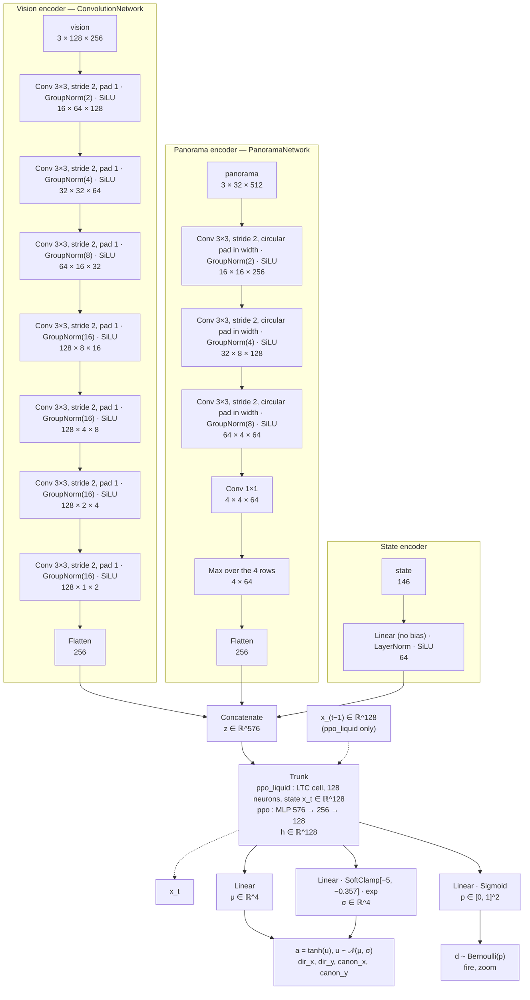
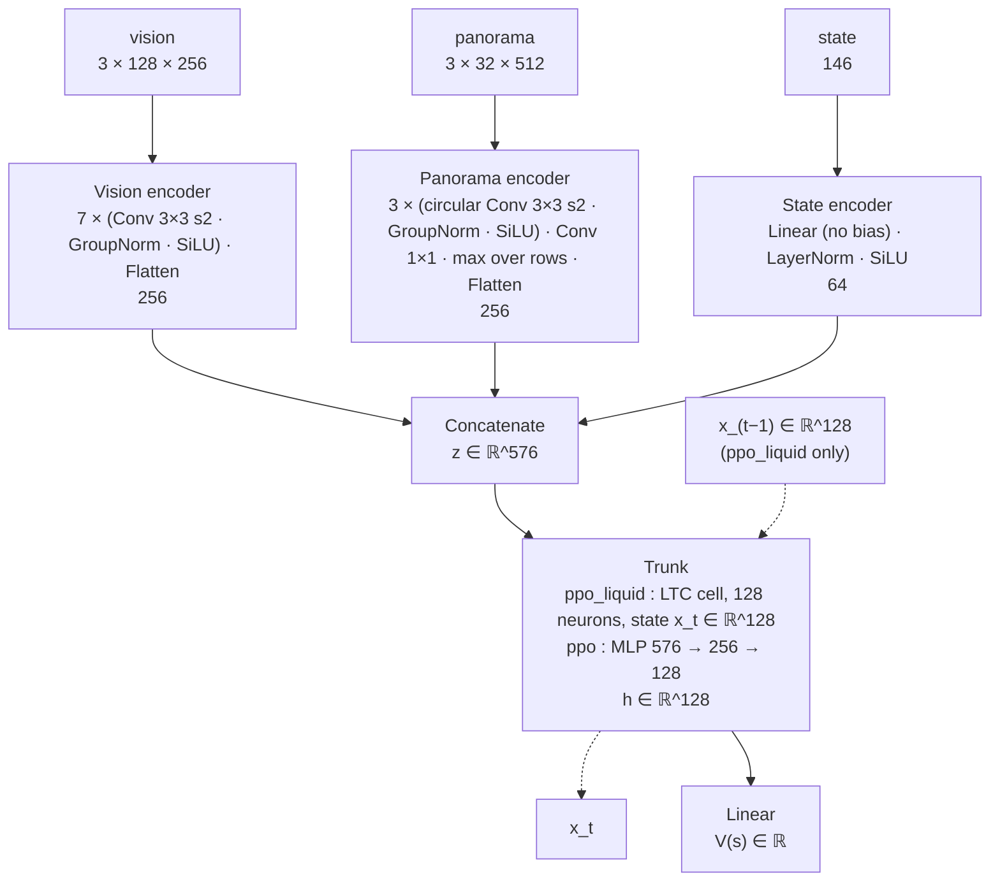

# Neural architecture

Actor and critic of `ppo` and `ppo_liquid`. Both agents share the three encoders and the heads;
they differ only by the **trunk**: an LTC cell (`ppo_liquid`) or an MLP (`ppo`). The actor and the
critic have the same structure and **no shared weight**.

Sizes below are the defaults (`liquid_ppo_hyperparams.h`, `ppo_hyperparams.h`) and the compile-time
constants of `arenai_core/types.h` and `arenai_model/constants.h`. $B$ is the batch size.

## Inputs

| input | tensor | content |
|---|---|---|
| vision | `uint8` $[B, 3, 128, 256]$ | camera on the canon, 79° wide (40° zoomed) |
| panorama | `uint8` $[B, 3, 32, 512]$ | 4 level views of 90° above the turret, side by side, left to right; the middle column is the canon heading, both ends meet straight behind; the tank's own parts are not drawn |
| state | `float` $[B, 146]$ | proprioception (144) + remaining shells ratio + cooldown ratio |

Both images are scaled to $[-1, 1]$ at the entry of their encoder: $x \leftarrow 2x/255 - 1$.

## Actor

## Critic

Same encoders and same trunk as the actor, with its own weights, ending on one value.

## Trunk

**LTC cell (`ppo_liquid`)**, `LiquidCell`. One decision integrates the state $x \in \mathbb{R}^{128}$
over $K = 6$ sub-steps of $\delta = \Delta t / K$, $\Delta t = 0.1$ s:

$$f = \operatorname{SiLU}(W_r\, x + W_z\, z + b), \qquad
x \leftarrow \frac{x + \delta\, f \odot a}{1 + \delta\,(1/\tau + f)}$$

$$h = \operatorname{SiLU}\big(\operatorname{LayerNorm}(W_o\, x)\big)$$

- $z \in \mathbb{R}^{576}$: the concatenated encodings; $W_z \in \mathbb{R}^{128 \times 576}$,
  $W_r \in \mathbb{R}^{128 \times 128}$, $W_o \in \mathbb{R}^{128 \times 128}$, none with a bias.
- $\tau = \operatorname{softplus}(\tau_{raw}) + 10^{-3} \in \mathbb{R}^{128}$: learned time
  constants, log-spaced at initialisation; $a \in \mathbb{R}^{128}$: learned, initialised at
  $1/\tau$.
- $x$ is carried from one decision to the next and reset at each episode start.

**MLP (`ppo`)**: two blocks `Linear (no bias) · LayerNorm · SiLU`, $576 \to 256 \to 128$; no memory.

## Heads

- **Continuous actions** (direction joystick, canon joystick): $u \sim \mathcal{N}(\mu, \sigma)$,
  $a = \tanh(u) \in [-1, 1]^4$. $\log \sigma$ goes through a `SoftClamp` (a sigmoid between the
  bounds) on $[-5, -0.357]$, so $\sigma \in [0.0067, 0.70]$.
- **Discrete actions** (fire, zoom): independent Bernoulli with probability $p$; fire is masked
  when the tank cannot fire.
- **Value**: one linear output, no activation.

## Panorama encoder details

- The panorama covers the full turn, so its left and right borders are neighbours: each strided
  convolution pads the width with the columns of the other border (circular) and the height with
  zeros.
- After three blocks one column spans 5.6° of bearing. The $1 \times 1$ convolution keeps 4
  channels per cell and the maximum over the 4 rows drops the height: the output is 4 channels ×
  64 bearing columns, flattened channel by channel.
