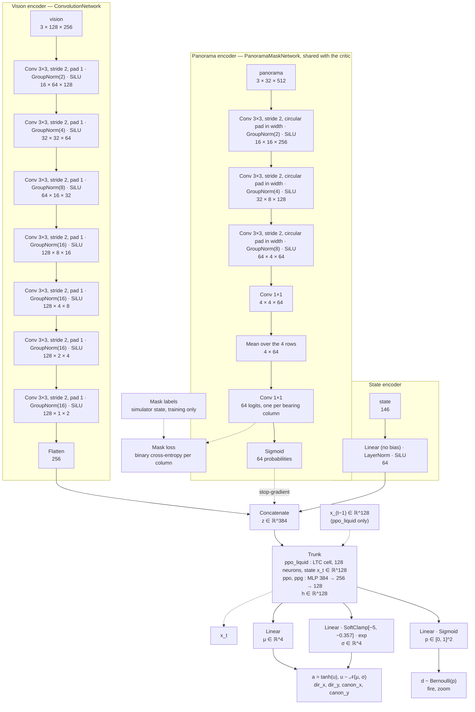
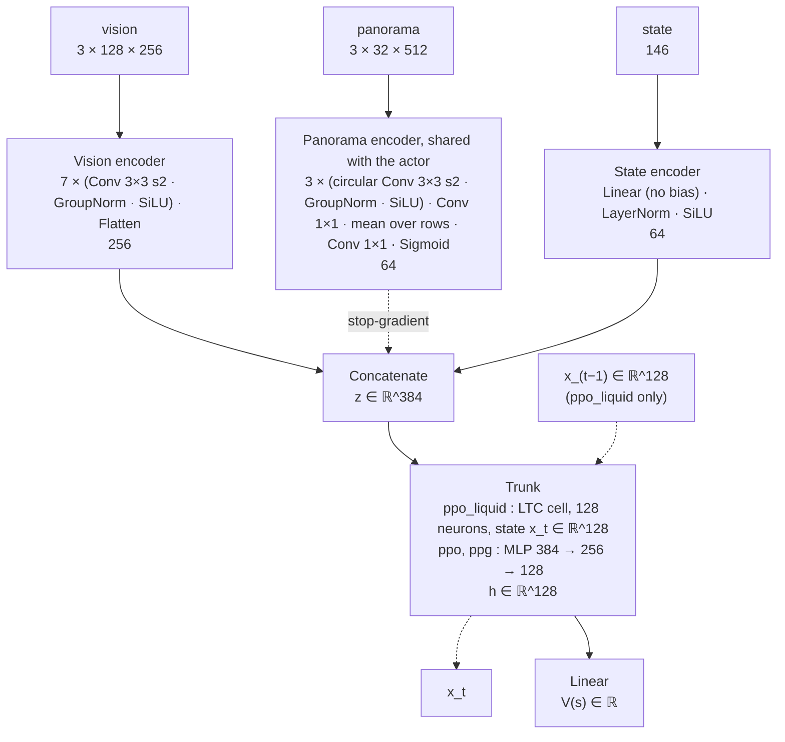
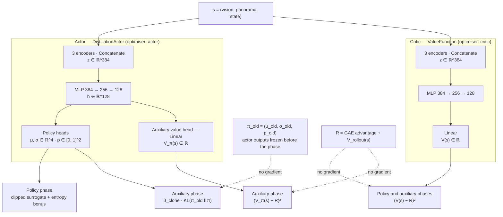
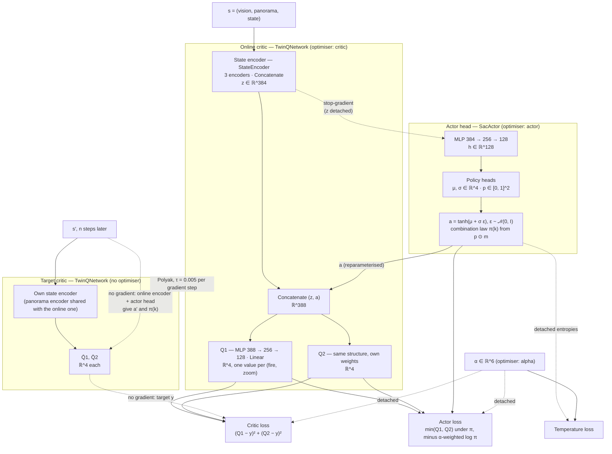

# Neural architecture

Actor and critic of the four agents: `ppo`, `ppo_liquid`, `ppg`, `sac`. All share the three
encoders (vision, panorama, state), the encoding $z \in \mathbb{R}^{384}$ and the policy heads.
In every agent one panorama encoder is shared by all its networks and trained only by its own
[mask loss](#mask-loss).

| agent | trunk | actor | critic | weights shared between actor and critic |
|---|---|---|---|---|
| `ppo` | MLP | [Actor](#actor) | [Critic](#critic), $V(s)$ | the panorama encoder |
| `ppo_liquid` | LTC cell | [Actor](#actor) | [Critic](#critic), $V(s)$ | the panorama encoder |
| `ppg` | MLP | [Actor](#actor) + auxiliary value head ([PPG](#ppg)) | [Critic](#critic), $V(s)$ | the panorama encoder |
| `sac` | MLP | trunk and heads on the critic's encoding ([SAC](#sac)) | twin $Q$ + target copy ([SAC](#sac)) | the three encoders; vision and state trained by the critic only, panorama by the mask loss only |

Sizes below are the defaults (`ppo_hyperparams.h`, `liquid_ppo_hyperparams.h`,
`ppg_hyperparams.h`, `sac_hyperparams.h`) and the compile-time constants of `arenai_core/types.h`
and `arenai_model/constants.h`. $B$ is the batch size.

## Inputs

| input | tensor | content |
|---|---|---|
| vision | `uint8` $[B, 3, 128, 256]$ | camera on the canon, 79° wide (45° zoomed) |
| panorama | `uint8` $[B, 3, 32, 512]$ | 4 level views of 90° above the turret, side by side, left to right; the middle column is the canon heading, both ends meet straight behind; the tank's own parts are not drawn |
| state | `float` $[B, 146]$ | proprioception (144) + remaining shells ratio + cooldown ratio |

Both images are scaled to $[-1, 1]$ at the entry of their encoder: $x \leftarrow 2x/255 - 1$.

## Actor

Actor of `ppo`, `ppo_liquid` and `ppg`. The `sac` actor has the same MLP trunk and the same heads
but reads $z$ from the critic's encoders ([SAC](#sac)). Dotted arrows carry no gradient or exist
at training time only.

## Critic

Critic of `ppo`, `ppo_liquid` and `ppg`: same encoders and same trunk as the actor, ending on one
value. The vision encoder, the state encoder and the trunk have their own weights; the panorama
encoder is the very instance the actor holds.

## Trunk

**LTC cell (`ppo_liquid`)**, `LiquidCell`. One decision integrates the state $x \in \mathbb{R}^{128}$
over $K = 6$ sub-steps of $\delta = \Delta t / K$, $\Delta t = 0.1$ s:

$$f = \operatorname{SiLU}(W_r\, x + W_z\, z + b), \qquad
x \leftarrow \frac{x + \delta\, f \odot a}{1 + \delta\,(1/\tau + f)}$$

$$h = \operatorname{SiLU}\big(\operatorname{LayerNorm}(W_o\, x)\big)$$

- $z \in \mathbb{R}^{384}$: the concatenated encodings; $W_z \in \mathbb{R}^{128 \times 384}$,
  $W_r \in \mathbb{R}^{128 \times 128}$, $W_o \in \mathbb{R}^{128 \times 128}$, none with a bias.
- $\tau = \operatorname{softplus}(\tau_{raw}) + 10^{-3} \in \mathbb{R}^{128}$: learned time
  constants, log-spaced at initialisation; $a \in \mathbb{R}^{128}$: learned, initialised at
  $1/\tau$.
- $x$ is carried from one decision to the next and redrawn from $0.1 \cdot \mathcal{N}(0, I)$ at
  each episode start.

**MLP (`ppo`, `ppg`, `sac`)**: two blocks `Linear (no bias) · LayerNorm · SiLU`,
$384 \to 256 \to 128$; no memory. The `sac` critics use the same two blocks on a wider input,
$388 \to 256 \to 128$ ([SAC](#sac)).

## Heads

- **Continuous actions** (direction joystick, canon joystick): $u \sim \mathcal{N}(\mu, \sigma)$,
  $a = \tanh(u) \in [-1, 1]^4$. $\log \sigma$ goes through a `SoftClamp` (a sigmoid between the
  bounds) on $[-5, -0.357]$, so $\sigma \in [0.0067, 0.70]$.
- **Discrete actions** (fire, zoom): independent Bernoulli with probability $p$. With
  $m \in \{0, 1\}^2$ the effect mask ($m_{fire} = 1$ iff the tank can fire, $m_{zoom} = 1$), a fire
  without effect carries no log-probability, no entropy and no gradient; `sac` also samples it
  from $p \odot m$, so it is never engaged.
- **Value**: one linear output, no activation.

## PPG

`ppg` is `ppo` with one more output on the actor and one more training phase. The critic is
unchanged.

**Network difference**: the actor (`DistillationActor`) carries an auxiliary value head
$V_\pi(s) = w^\top h + b$, one `Linear` $128 \to 1$ on the trunk output $h$, beside $\mu$, $\sigma$
and $p$. It is not read when acting.

**Phases.** A policy phase runs on each rollout; after every `n_pi` $= 8$ policy phases an
auxiliary phase runs on the rows of that same rollout.

| phase | epochs | loss | weights updated |
|---|---|---|---|
| policy, actor | 4 | clipped surrogate + entropy bonus, as `ppo` | actor: encoders, trunk, $\mu$, $\sigma$, $p$ heads; $V_\pi$ head receives no gradient |
| policy, critic | 8 | $(V(s) - R)^2$ | critic |
| auxiliary, actor | 4 | $L_{aux}$ | the whole actor, $V_\pi$ head included |
| auxiliary, critic | 4 | $(V(s) - R)^2$ | critic |

**Auxiliary loss.** The return target $R$ is distilled into the actor's features through $V_\pi$
while a behaviour-cloning term holds the policy where it was:

$$L_{aux} = \mathbb{E}_s\Big[\big(V_\pi(s) - R(s)\big)^2
+ \beta_{clone}\,\big(D_c(s) + D_d(s)\big)\Big]$$

$$D_c = \sum_{i=1}^{4} \left[\log\frac{\sigma_i}{\sigma_i^{old}}
+ \frac{(\sigma_i^{old})^2 + (\mu_i^{old} - \mu_i)^2}{2\,\sigma_i^2} - \frac12\right],
\qquad
D_d = \sum_{j \in \{fire,\, zoom\}} m_j \left[p_j^{old} \log\frac{p_j^{old}}{p_j}
+ (1 - p_j^{old}) \log\frac{1 - p_j^{old}}{1 - p_j}\right]$$

- $R(s)$: the return of the rollout, GAE advantage plus the value the critic gave when the rollout
  was evaluated; the same target as the critic's, a constant for both networks.
- $(\mu^{old}, \sigma^{old}, p^{old})$: the actor's outputs on every row of the rollout, computed
  once without gradient when the auxiliary phase starts.
- $D_c$: $\mathrm{KL}(\pi_{old} \,\|\, \pi)$ of the normals before the squash, which the $\tanh$
  leaves unchanged; $D_d$: the same divergence for the Bernoulli heads, masked by $m$.
- $\beta_{clone} = 1$.

No gradient crosses between the two networks in either phase: the critic never sees $V_\pi$, the
actor never sees $V$.

## SAC

`sac` replaces the value critic by action-value critics and trains the vision and state encoders
through them only; the panorama encoder is trained by the [mask loss](#mask-loss) alone.

### Critics

- **State encoder**: the three encoders of the [Actor](#actor) diagram and their concatenation,
  $z \in \mathbb{R}^{384}$, one instance held by the online critic and read by the actor.
- **How actions enter**: the continuous action $a \in [-1, 1]^4$ (after $\tanh$) is concatenated to
  $z$ at the input; the discrete actions are not inputs but index the output. Each critic returns
  $Q(s, a, \cdot) \in \mathbb{R}^{4}$, one value per combination $k \in \{0, \dots, 3\}$ of the
  $n_d = 2$ discrete actions, $k = d_{fire} + 2\, d_{zoom}$.
- **Each critic** $Q_c$, $c \in \{1, 2\}$: two blocks `Linear (no bias) · LayerNorm · SiLU`,
  $388 \to 256 \to 128$, then `Linear` $128 \to 4$. $Q_1$ and $Q_2$ have separate weights and share
  the state encoder.
- **Target critic** $\bar Q_1, \bar Q_2$: a full copy with its own state encoder (vision and state
  encoders copied, panorama encoder shared with the online critic), initialised equal
  to the online critic, never differentiated, moved after each gradient step by
  $\bar\theta \leftarrow \tau\,\theta + (1 - \tau)\,\bar\theta$, $\tau = 0.005$.

### Actor head

`SacActor`: the MLP trunk $384 \to 256 \to 128$ and the three heads of the [Actor](#actor) diagram,
applied to the critic's $z$. It owns no encoder weight: the actor optimiser holds only the trunk
and the heads.

### Losses and gradient stops

Notation: $\pi_i(a_i \mid s)$ the density of continuous axis $i$; $\pi_j(d \mid s)$ the Bernoulli
of discrete action $j$ with probability $p_j$; $\pi(k \mid s) = \prod_j \operatorname{Bern}(k_j;\,
p_j m_j)$ the probability of combination $k$, $k_j$ its bit $j$; $\alpha^c \in \mathbb{R}^4$,
$\alpha^d \in \mathbb{R}^2$ the temperatures.

Soft value of a state, exact over the four discrete combinations, one sample
$a \sim \pi(\cdot \mid s)$ on the continuous actions:

$$V_Q(s) = \sum_{k=0}^{3} \pi(k \mid s)\Big[\min_c Q_c(s, a, k)
- \sum_j \alpha^d_j\, m_j \log \pi_j(k_j \mid s)\Big] - \sum_{i=1}^{4} \alpha^c_i \log \pi_i(a_i \mid s)$$

**Critic.** With $(s_t, a_t, k_t)$ a replayed transition, $n' \le n = 10$ the steps actually summed
(the sum stops at an episode cut: death or truncation, after which nothing is bootstrapped), $\gamma = 0.99$, $r$ the reward and $\bar V$ the soft value
computed with $\bar Q_c$:

$$y = \sum_{l=0}^{n'-1} \gamma^l r_{t+l} + \gamma^{n'} \bar V(s_{t+n'}) \cdot
\mathbb{1}[\text{no cut}],
\qquad
L_Q = \mathbb{E}\Big[\big(Q_1(s_t, a_t, k_t) - y\big)^2 + \big(Q_2(s_t, a_t, k_t) - y\big)^2\Big]$$

**Actor.** With $\bar z$ the detached encoding of $s$ and $a = \tanh(\mu + \sigma \varepsilon)$:

$$L_\pi = \mathbb{E}\Big[\sum_{i=1}^{4} \alpha^c_i \log \pi_i(a_i \mid s)
+ \sum_{k=0}^{3} \pi(k \mid s)\Big(\sum_j \alpha^d_j\, m_j \log \pi_j(k_j \mid s)
- \min_c Q_c(\bar z, a, k)\Big)\Big]$$

| loss | weights updated | gradient stops |
|---|---|---|
| $L_Q$ | vision and state encoders, $Q_1$, $Q_2$ | $y$ is computed without gradient: target critic, actor head and online encoder on $s_{t+n'}$, temperatures |
| $L_\pi$ | actor trunk and heads | $z$ detached before the actor trunk and before the $Q$ heads: nothing reaches the encoders; the gradient crosses $Q_1$, $Q_2$ to $a$ and to $\pi(k \mid s)$ but the actor optimiser holds no critic weight; temperatures detached |
| $L_\alpha$ | $\log \alpha$ | log-probabilities and entropies detached |

### Entropy temperatures

One temperature per action, $\alpha = \exp(\log \alpha) \in \mathbb{R}^{6}$ (4 continuous axes,
then fire and zoom), $\log \alpha$ a free parameter without bound, initialised at
$\alpha = 5 \cdot 10^{-4}$, with its own optimiser.

$$L_\alpha = -\sum_{i=1}^{4} \log \alpha^c_i \;\mathbb{E}\big[\log \pi_i(a_i \mid s) + \bar H_c\big]
- \sum_j \log \alpha^d_j \;\mathbb{E}\big[\bar H_d\, m_j - H_j(s)\big]$$

- $\bar H_c$: continuous target per axis, the entropy of $\tanh(u)$, $u \sim \mathcal{N}(0,
  0.1^2)$ (`target_sigma` $= 0.1$), estimated by sampling when the trainer is built.
- $\bar H_d = 0.3 \ln 2$: discrete target, a share (`discrete_target_entropy_ratio`) of the
  maximum Bernoulli entropy.
- $H_j(s) = -\sum_k \pi(k \mid s)\, m_j \log \pi_j(k_j \mid s)$: entropy of discrete action $j$,
  zero when it has no effect.
- A temperature rises when its action's entropy is under the target and falls otherwise.

## Panorama encoder details

`PanoramaMaskNetwork`, one instance per agent, built by the agent's factory and injected into each
of its networks: it is written in both `actor.pt` and `critic.pt`, and the game needs `actor.pt`
only.

- The panorama covers the full turn, so its left and right borders are neighbours: each strided
  convolution pads the width with the columns of the other border (circular) and the height with
  zeros.
- After three blocks one column spans 5.625° of bearing. A $1 \times 1$ convolution keeps 4
  channels per cell, the mean over the 4 rows drops the height, and a second $1 \times 1$
  convolution gives one logit $\ell_j$ per bearing column $j \in \{0, \dots, 63\}$. Column 0 starts
  straight behind and the index grows turning right; the canon heading is the border between
  columns 31 and 32.
- The trunks read $p_j = \sigma(\ell_j)$, detached: no policy, value or $Q$ loss sends a gradient
  to the encoder.

### Mask loss

The encoder is trained alone, by its own Adam optimiser (`PanoramaMaskLearner`, learning rate
$3 \cdot 10^{-4}$, batches of 512 panoramas, one pass), to predict which bearing columns hold a
visible enemy:

$$\mathcal{L}_{mask}=\frac{1}{\sum_j m_j}\sum_{j=0}^{63} m_j\,\mathrm{BCE}\big(\ell_j,\ y_j\big)$$

- $y_j = 1$ when an enemy closer than 400 m, in sight, has its bearing in column $j$; else 0. In
  sight: the segment from the panorama camera to the top of the enemy's turret meets no obstacle,
  and its elevation is inside the panorama's vertical field ($\pm 14°$).
- $m_j = 0$ on an ambiguous column — one an enemy overlaps by its angular half-width
  $\arctan(4\,\text{m} / \text{distance})$ while being out of sight, too far, or centred in
  another column — and 1 elsewhere. A column with $y_j = 1$ always has $m_j = 1$.
- The labels come from the simulator state (`TrainTankEnvironment::enemy_sightings`, then the pure
  function `panorama_mask_labels`), at training time only: the game runs the encoder on the image
  alone.
- The training loop gives the learner every panorama with its sightings; each trainer calls
  `fit()` right after its own update, so a rollout is collected and optimised with the same
  encoder. `fit()` passes over the panoramas observed since the previous call, then forgets them.
