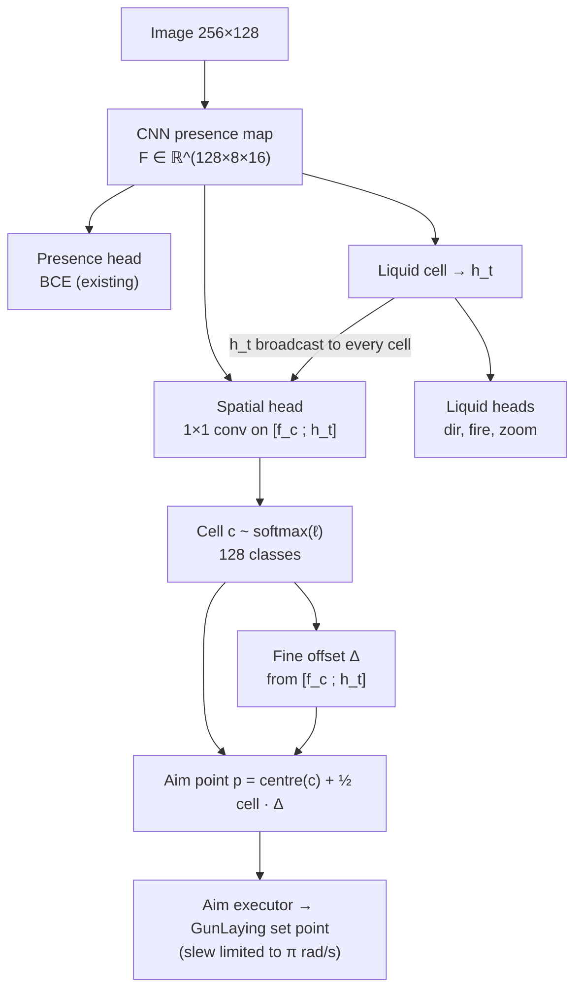

# Spatial aim

The agent aims by **choosing a point in its own image** instead of commanding a turret and canon
velocity. Training is unchanged (same PPO, critic, GAE, clip); only the aim action and where it is
read in the network change.

## Why

- With a velocity command, aiming at a target is a chain of decisions spread over ~2 s; the event
  reward (hit, kill) credits the aim gesture with a correlation $\rho \le 0.03$. The turret never
  learns to servo on a visible target, even when the target position is given as input (run 548).
- The CNN already detects visible enemies (presence map, 0.98 at < 100 m in run 552).
- Measured ceiling (probe, `--oracle_target network`): aiming at the enemy designated by the
  network's own presence map, with the policy's trigger, multiplies hits per tank-second by
  2.2 / 2.7 (run 552, sides 550 / 1000) and 1.8 / 2.9 (run 433, 4-block CNN + spatial softmax).

## Structure

- `F`: the CNN map the presence head reads — after block 4 in the 7-block CNN (552), the final
  map in the 4-block CNN with spatial softmax (433).
- `f_c ∈ ℝ^128`: the feature of cell `c`; `h_t`: the liquid-cell state (memory, proprioception).

## Action law

$$\ell_c = w^\top [f_c ; h_t] + b,\qquad c \sim \operatorname{softmax}(\ell),\qquad
\Delta = \tanh(u),\; u \sim \mathcal{N}\big(\mu(f_c, h_t), \sigma\big)$$

$$\log \pi(c, \Delta \mid s) = \log \operatorname{softmax}(\ell)_c + \log \mathcal{N}(u) -
\textstyle\sum_k \log(1 - \Delta_k^2)$$

- $\Delta \in [-1, 1]^2$ spans half a cell: ±2.5° unzoomed, ±1.25° zoomed.
- PPO gradients reach the CNN through the spatial head and the liquid cell through $h_t$.

## Why it is not the absolute-angle aim again (runs 411, 413, 505)

Those failed because one $\sigma$ over the whole angular range dispersed the set point by ±70-78°.
Here the cell choice is categorical (its entropy can go to 0) and $\Delta$ only spans half a cell,
so $\sigma = 0.3$ gives ~0.75°.

## Search out of view

Aiming at an edge cell asks for more than one decision of slew (18°), so the turret turns at full
speed on that side: sweeping stays expressible without a dedicated action.

## Open pieces

- **Aim executor**: who turns the image point into the GunLaying set point (needs the camera:
  field of view per zoom, offset (0, 4, −20), convergence at 100 m). Constraint: no field may
  carry two meanings (player velocity vs agent point).
- Learning is not measured: the probe ceiling uses a perfect $\Delta$.
