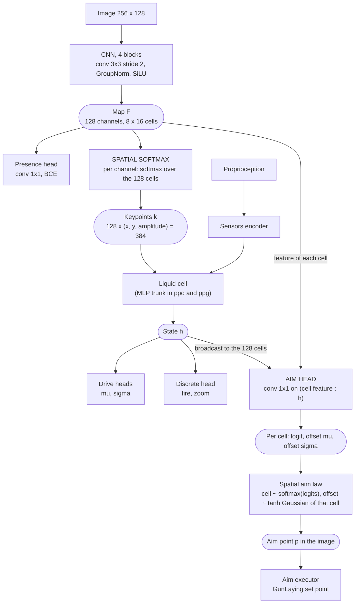

# Spatial aim

The agent aims by **choosing a point in its own image** instead of commanding a turret and canon
velocity. Training is unchanged (same PPO, critic, GAE, clip); only the aim action and where it is
read in the network change.

## Why

- With a velocity command, aiming at a target is a chain of decisions spread over ~2 s; the event
  reward (hit, kill) credits the aim gesture with a correlation $\rho \le 0.03$. The turret never
  learns to servo on a visible target, even when the target position is given as input (run 548).
- The CNN already detects visible enemies (presence map, 0.98 at < 100 m in run 552).
- Measured ceiling (probe, `--oracle_target network`): aiming at the enemy designated by the
  network's own presence map, with the policy's trigger, multiplies hits per tank-second by
  2.2 / 2.7 (run 552, sides 550 / 1000) and 1.8 / 2.9 (run 433, 4-block CNN + spatial softmax).

## Structure

The CNN map feeds **two readers**. The spatial softmax compresses it into keypoints for the
state path; the aim head reads it cell by cell, uncompressed.

Every edge carries gradients; nothing is detached. The PPO aim gradient reaches the CNN by two
routes: directly through the aim head, and through the spatial softmax and the state $h$.

## Spatial softmax

It is the layer between the map and the state path (`ConvolutionNetwork::encode`). It is **not**
the softmax that draws the aim cell.

Notation: $F_{k,j}$ is the map value of channel $k$ at cell $j$, $x_j$ is the centre of cell $j$
with both coordinates in $[-1, 1]$, and $\tau_k > 0$ is a learned temperature per channel.

$$
a_{k,j} = \frac{\exp(F_{k,j} / \tau_k)}{\sum_{i} \exp(F_{k,i} / \tau_k)}
$$

$$
\kappa_k = \sum_{j} a_{k,j} x_j
\qquad
m_k = \sum_{j} a_{k,j} F_{k,j}
$$

- $a_{k,j}$: attention of channel $k$ on cell $j$.
- $\kappa_k$: keypoint of channel $k$, the mean position of its attention (2 numbers).
- $m_k$: amplitude of channel $k$, its attended activation (1 number).

The state path receives the 128 triplets $(\kappa_k, m_k)$, 384 numbers. One keypoint is a mean
over the image: precise for one blob, ambiguous for several. That is why the aim head reads $F$
itself and not the keypoints.

## Aim head

One 1×1 convolution over the map, each cell concatenated with the state (`AimHead`).

Notation: $f_c$ is the feature vector of cell $c$ (the 128 channels of $F$ at that cell), $h$ is
the state, $[f_c ; h]$ is their concatenation, $W$ and $b$ are the weights and bias of the
convolution, 5 outputs per cell.

$$
\left( \ell_c , \mu_c , \eta_c \right) = W [f_c ; h] + b
$$

- $\ell_c$: logit of cell $c$ (1 number).
- $\mu_c$: mean of the offset inside cell $c$ before squashing (2 numbers).
- $\eta_c$: log standard deviation of that offset (2 numbers); $\sigma_c = \exp(\eta_c)$ after a
  soft clamp.

## Action law

`SpatialAimLaw`. The cell is categorical, the offset is a squashed Gaussian read at the drawn
cell.

$$
q_c = \frac{\exp(\ell_c)}{\sum_{i} \exp(\ell_i)}
\qquad
c \sim q
$$

$$
u \sim \mathcal{N}(\mu_c, \sigma_c)
\qquad
\Delta = \tanh(u)
$$

$$
\log \pi(c, \Delta \mid s) = \log q_c
+ \sum_{i=1}^{2} \left[ \log \mathcal{N}(u_i ; \mu_{c,i}, \sigma_{c,i}) - \log(1 - \Delta_i^2) \right]
$$

- $q_c$: probability of cell $c$ among the 128.
- $u$: offset before squashing; $\Delta$: offset, both coordinates in $[-1, 1]$.
- $s$: the observation; $i$ indexes the two image axes.

The aim point, in normalized image coordinates ($x$ to the right, $y$ up, both in $[-1, 1]$),
for a map of $R = 8$ rows and $C = 16$ columns, the drawn cell being at row $r$ and column $n$:

$$
p_x = \frac{2n + 1}{C} - 1 + \frac{\Delta_1}{C}
\qquad
p_y = 1 - \frac{2r + 1}{R} + \frac{\Delta_2}{R}
$$

$\Delta$ spans half a cell on each side of the cell centre: ±2.5° unzoomed, ±1.25° zoomed.

## Aim executor

`JoltEnemyTank::apply_command` turns the image point into the GunLaying set point, with the
view-projection matrix $M$ of the image the agent observed.

Notation: $e$ and $g$ are the points of the near and far planes that project onto $p$, $o$ is
the canon origin, $l$ is the canon's convergence point.

$$
e = M^{-1}(p, 0)
\qquad
g = M^{-1}(p, 1)
\qquad
d = \frac{g - e}{\lVert g - e \rVert}
$$

$$
t = e + \lVert l - e \rVert d
$$

The set point is the direction $t - o$: the canon is laid on the point of the observed ray that
is as far from the eye as the image centre's convergence point. GunLaying then slews towards it
(limited to π rad/s).

## Why it is not the absolute-angle aim again (runs 411, 413, 505)

Those failed because one $\sigma$ over the whole angular range dispersed the set point by ±70-78°.
Here the cell choice is categorical (its entropy can go to 0) and $\Delta$ only spans half a cell,
so $\sigma = 0.3$ gives ~0.75°.

## Search out of view

Aiming at an edge cell asks for more than one decision of slew (18°), so the turret turns at full
speed on that side: sweeping stays expressible without a dedicated action.

## Open

- Learning is not measured: the probe ceiling uses a perfect $\Delta$.
